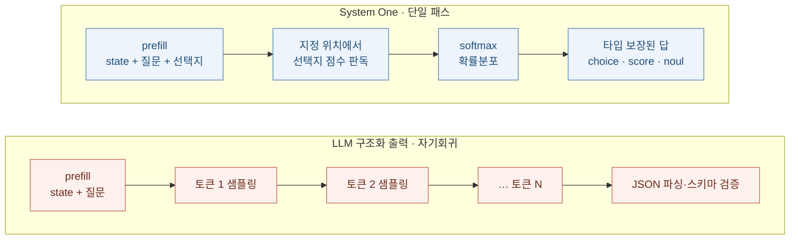
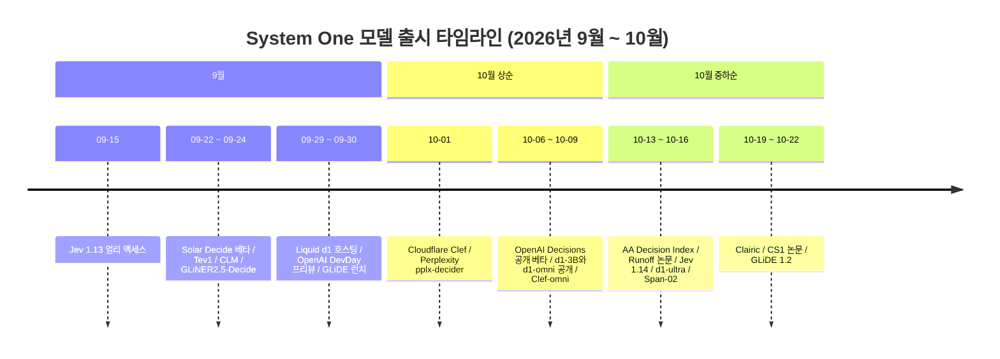
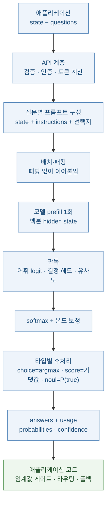
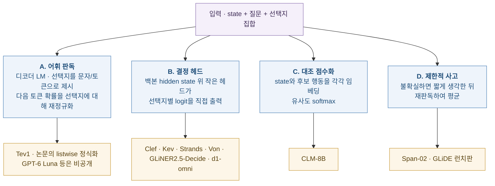
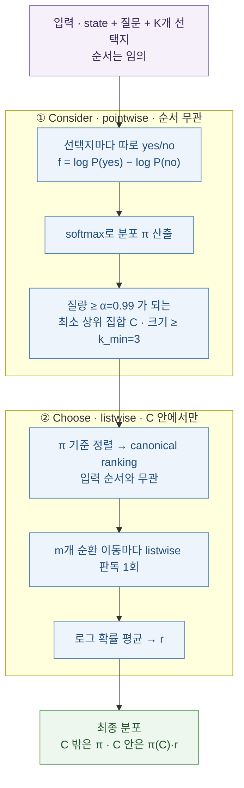
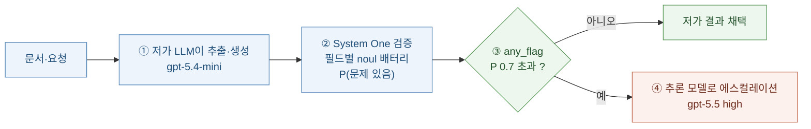
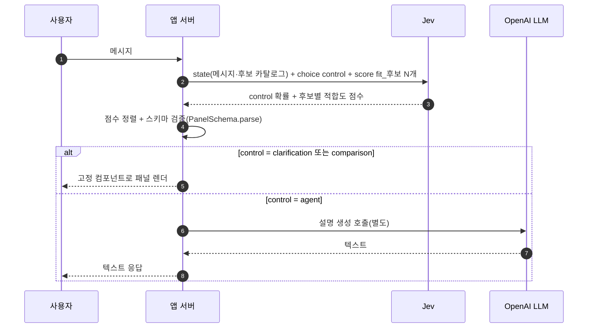

# Jev와 System One 모델 해부

> 📊 **발표자료**: [jev-decision-models-presentation.pptx](./jev-decision-models-presentation.pptx)

<div class="doc-hero" markdown="1">
**이 글이 답하려는 질문** — 2026년 9월 15일 TypeSafe AI의 **Jev**가 "텍스트를 생성하지 않고 타입이 있는 확률 분포만 돌려주는 모델"이라는 범주(System One 모델)를 열었고, 5주 만에 OpenAI·Liquid AI·Cloudflare·Perplexity·Fastino 등 30여 개 후속 모델이 쏟아졌다. 이 모델들은 **무엇을 입력으로 받고(입출력 형식), 내부에서 실제로 무엇을 계산하며(실행 방식), 어떻게 돌려 쓰는가(실행 방법)**. 그리고 어디까지가 벤더가 확인해 준 사실이고 어디부터가 집계 사이트의 전언인가.

**3줄 요약**
1. 사실상의 표준 계약은 **`state` + 이름 붙은 `questions`(choice / score / noul) → 질문별 `probabilities`·`confidence`·`usage`** 이다. Jev가 만든 이 JSON 계약을 Cloudflare·Fastino·Perplexity 등이 호환 구현했고, OpenAI만 `input` + 배열형 `questions`·`predicate`라는 변형을 쓴다. `score`는 레벨 번호의 **확률 가중 기댓값**이며, `confidence`는 OpenAI까지 같은 수식으로 수렴했다.
2. "단일 forward pass, 출력 토큰 0"은 정확히는 **자기회귀 디코딩을 하지 않고 prefill 한 번 뒤 선택지 위치의 점수를 읽는다**는 뜻이다. 구현은 크게 셋과 변종 하나로 갈린다 — **어휘 판독**(디코더 LM의 선택지 토큰 확률), **결정 헤드**(Clef·Kev·Strands는 디코더 백본, GLiNER2.5-Decide·Von·d1-omni는 양방향 인코더 백본), **대조 점수화**(CLM), 그리고 불확실할 때만 짧게 생각하는 변종(Span-02). **Jev 자체의 내부는 비공개**다.
3. 선택지 순서 의존성(Jev 1.13도 평균 5.3%가 순서만 바꿔도 뒤집힘)은 구조적 약점이고, 훈련 없이 **Runoff**(consider → choose)로 상당 부분 제거된다. 실전에서는 **신뢰도 게이팅 + LLM 폴백 캐스케이드**가 정석이며, 결정 모델은 지식·추론 과제에서 **과신**하므로 임계값을 자기 데이터로 맞춰야 한다.
</div>

<div class="toc" markdown="1">
<span class="toc-title">목차</span>
1. [정의와 배경 — System One이란 무엇이고 왜 지금인가](#sec1)
2. [입출력 사양 — 실제 JSON으로 보는 벤더별 계약](#sec2)
3. [실행 방식 — "한 번의 forward pass"의 실체와 네 가지 계열](#sec3)
4. [선택지 순서 의존성과 Runoff](#sec4)
5. [모델 지형 — 누가 무엇을 냈나](#sec5)
6. [벤치마크·비용·지연 — 숫자가 서로 어긋나는 이유](#sec6)
7. [실전 패턴 — 게이팅·캐스케이드·팬아웃·UI 라우터](#sec7)
8. [아직 모르는 것](#sec8)
9. [참고문헌](#sec9)
10. [학습 퀴즈](#sec10)
</div>

---

## 1. 정의와 배경 — System One이란 무엇이고 왜 지금인가 {#sec1}

### 1.1 정의

**System One 모델**은 TypeSafe AI가 붙인 이름으로, 카너먼의 빠른 사고(System 1)에서 따왔다. 입력은 비정형 **상태(state)** 와 **타입이 정해진 질문**이고, 출력은 문자열이 아니라 **정답 후보 위의 확률분포**다. 공식 문서의 정의는 이렇다 — 이 모델은 답장·코드·추론 설명을 쓰지 않고, 개발자가 `choice`·`score`·`noul` 같은 primitive로 가능한 답의 집합을 미리 정한다. 같은 문서는 "교정(calibration)은 예측 묶음에 대한 성질이며 개별 답의 정답을 보장하지 않는다"고 못 박는다. [\[5\]](#ref5){:.cite}



TypeSafe는 이를 "비정형 상태가 들어가면 타입이 있는 확률적 결정이 나오는 *프런티어급 함수 호출*"이라 요약한다. [\[13\]](#ref13){:.cite} 생성을 포기하는 대신 얻는 것은 세 가지다 — 스키마 오류가 구조적으로 없고, 모든 후보에 확률이 붙고, 지연이 디코딩 길이와 무관하다.

### 1.2 사실과 주장을 가르는 표기

이 분야는 5주 만에 급조된 시장이라 정보원이 고르지 않다. 이 글은 근거를 세 등급으로 표기한다.

| 등급 | 의미 | 예 |
| :--- | :--- | :--- |
| **벤더 확인** | 벤더 공식 문서·모델 카드·논문 | TypeSafe 문서, OpenAI Decisions 가이드, Liquid·Cloudflare 블로그와 HF 카드, arXiv |
| **집계 인용** | systemonemodels.org 등 제3자 디렉터리가 정리한 값 | 대부분의 가격·컨텍스트·공개일, 다수 후속 모델의 구조 서술 |
| **추론** | 위 자료에서 이 글이 직접 계산·해석한 것 | confidence 수식 일치, output_tokens의 질문당 약 20개 패턴 등 |

### 1.3 Jev의 공개 사양

| 항목 | 값 | 근거 |
| :--- | :--- | :--- |
| 공개 | 2026-09-15 얼리 액세스(대기자 명단) | 벤더 확인 [\[13\]](#ref13){:.cite} |
| 모델 ID | `jev-1.13.0`(= `jev-latest`, SDK 기본), `jev-1.14.0`(= `jev-preview`, 2026-10-14) | 벤더 확인 [\[4\]](#ref4){:.cite}[\[14\]](#ref14){:.cite} |
| 입력 | 텍스트(문자열·JSON·배열). 이미지는 1.14의 실험적 "danger zone" 옵트인 | 벤더 확인 [\[4\]](#ref4){:.cite}[\[14\]](#ref14){:.cite} |
| 컨텍스트 | 요청당 64k, **질문당 32k**(state + 해당 질문). 장문 헤더로 262k(더 느리고 부정확) | 벤더 확인 [\[4\]](#ref4){:.cite} |
| 가격 | 입력 $0.042/MTok, 출력 무료 | 벤더 확인 [\[4\]](#ref4){:.cite} |
| 지연 | 종단 70–500 ms (회사 주장, 서부 해안 노트북에서 측정) | 벤더 확인 [\[13\]](#ref13){:.cite} |
| 내부 구조 | "새 아키텍처, 병렬 샘플러, RLCD 학습"이라는 서술 외 **비공개** | 벤더 확인 [\[13\]](#ref13){:.cite}[\[15\]](#ref15){:.cite} |

1.14에서 `box` 타입(이미지 속 경계 상자 하나)이 추가됐고, 1.13 폐기에는 60일, 1.14에는 30일 예고를 약속했다. [\[14\]](#ref14){:.cite}

> 출시 글은 "Jev는 문자열 생성을 포기했고 구조화 출력에 최적화되어 있어서 *환각할 수 없다*"고 쓰지만, 같은 글이 스스로 밝히는 한계도 있다 — 얼리 액세스 단계이고, 가격은 보조금일 가능성을 인정하며, 비교 기준 답안이 OpenAI·Anthropic 모델에서 나왔고 워크플로 평가를 회사 자체 팀이 만들었다. [\[13\]](#ref13){:.cite}

"환각할 수 없다"는 **스키마상 존재하지 않는 값을 낼 수 없다**는 뜻이지 **고른 선택지가 사실이라는 뜻이 아니다.** 후자는 7장의 과신 문제로 이어진다.

### 1.4 왜 5주 만에 30여 개인가



날짜는 벤더 공지가 확인된 것(Jev, OpenAI, Cloudflare Clairic, Runoff, CS1, AA)과 집계 사이트 표기에 의존한 것(나머지)이 섞여 있다. [\[41\]](#ref41){:.cite}[\[52\]](#ref52){:.cite} 공통 배경은 둘이다. 하나는 **Jev가 JSON 계약을 공개해 호환 구현의 진입 장벽을 낮춘 것**이고(Clef는 "fully Jev-API compatible"을 내세우고, Kev·Von·CLM·Strands는 `/v1/systemone` 서버를 직접 제공한다 [\[28\]](#ref28){:.cite}[\[44\]](#ref44){:.cite}[\[45\]](#ref45){:.cite}), 다른 하나는 Qwen3.5/3.8·Gemma 4 같은 오픈 백본 위에 **LoRA + 작은 헤드**만 얹어도 만들 수 있다는 점이다(3장).

---

## 2. 입출력 사양 — 실제 JSON으로 보는 벤더별 계약 {#sec2}

### 2.1 공통 골격: 세 가지 primitive

모든 벤더가 공유하는 개념은 같다. **state 하나에 이름 붙은 질문 여럿**을 붙이고, 질문마다 독립적으로 답을 받는다.

| primitive | 묻는 것 | 넣는 것 | 돌려받는 것 |
| :--- | :--- | :--- | :--- |
| **noul** (OpenAI: `predicate`) | 참/거짓 | `instructions`(+선택 `criteria.true/false`) | P(true) 하나. 별도 `confidence` 없음(확률 자체가 불확실성) [\[8\]](#ref8){:.cite} |
| **choice** | 여러 후보 중 하나 | `criteria`: 라벨 → 설명 맵 (**최대 255개**) [\[2\]](#ref2){:.cite} | `choice`(최댓값), `probabilities`, `confidence` |
| **score** | 순서 있는 척도 위 위치 | `criteria`: 레벨 설명의 **순서 있는 배열**(API 상한 10단계) [\[2\]](#ref2){:.cite} | `score`(기댓값), `probabilities`, `legend`, `confidence` |

몇 가지 설계 규칙이 문서 곳곳에 흩어져 있다. 질문은 **서로의 답을 볼 수 없고**(독립 평가) [\[9\]](#ref9){:.cite}[\[16\]](#ref16){:.cite}, score 레벨은 "번호도 이웃 레벨도 모르고 설명만 본다" — 따라서 "정도"가 아니라 "상황"을 서술해야 한다. [\[7\]](#ref7){:.cite} 질문 ID는 모델에 전달되지 않고 응답 키로만 쓰인다. [\[7\]](#ref7){:.cite}

### 2.2 Jev: 요청과 응답

엔드포인트는 `POST https://api.typesafe.ai/v1/systemone`, 인증은 Bearer 키다. [\[2\]](#ref2){:.cite} 아래는 문서의 스키마에 맞춰 이 글이 직접 구성한 예시(실제 호출 결과가 아니다)다.

```json
{
  "model": "jev-1.13.0",
  "state": {
    "ticket": "결제가 이번 달에 두 번 됐어요. 한 건은 환불해 주세요.",
    "plan": "pro"
  },
  "questions": {
    "team": {
      "type": "choice",
      "instructions": "이 문의를 처리할 팀은?",
      "criteria": {
        "billing": "결제, 청구서, 환불",
        "technical": "앱·사이트 오류",
        "fraud": "무단 사용 의심"
      }
    },
    "urgency": {
      "type": "score",
      "instructions": "얼마나 급한가?",
      "criteria": ["기다려도 됨", "오늘 안에", "지금 고객이 막혀 있음"]
    },
    "refund": {
      "type": "noul",
      "instructions": "고객이 환불을 요청하는가?"
    }
  }
}
```

```json
{
  "model": "jev-1.13.0",
  "answers": {
    "team": {
      "type": "choice",
      "choice": "billing",
      "confidence": 0.895,
      "probabilities": { "billing": 0.93, "technical": 0.04, "fraud": 0.03 }
    },
    "urgency": {
      "type": "score",
      "score": 1.65,
      "confidence": 0.475,
      "legend": { "0": "기다려도 됨", "1": "오늘 안에", "2": "지금 고객이 막혀 있음" },
      "probabilities": { "0": 0.05, "1": 0.25, "2": 0.70 }
    },
    "refund": { "type": "noul", "noul": 0.97 }
  }
}
```

실제 응답에는 `usage: {input_tokens, output_tokens}`도 붙는다. 이 필드의 성격은 2.7절에서 다룬다.

SDK는 `typesafe-sdk`(Python 3.10+)와 `@typesafe-ai/sdk`(Node 20+)다. 파이썬에서는 `Choice`/`Score`/`Noul` 클래스로 질문을 만들고 `client.system_one(state=..., questions=...)`를 부르며, TS SDK는 질문 정의에서 **답 타입을 유니온으로 추론**해 준다. [\[1\]](#ref1){:.cite}[\[16\]](#ref16){:.cite} 쿡북이 쓰는 형태는 다음과 같다. [\[18\]](#ref18){:.cite}

```python
from typesafe_sdk import Noul, NoulCriteria, TypeSafeClient

client = TypeSafeClient(api_key=os.environ["TYPESAFE_API_KEY"], timeout=120.0)
q = Noul(
    instructions="이 후보 구절이 인용된 판례의 구절인가?",
    criteria=NoulCriteria(true="질의가 인용한 구체적 규칙을 서술한다.",
                          false="주제만 비슷하다."),
)
r = client.system_one(state={"query": query, "candidate": cand},
                      questions={"is_cited": q}, model="jev-1.13.0")
p_yes = r.answers["is_cited"].noul
```

### 2.3 요청 규칙과 오류

| 항목 | 값 |
| :--- | :--- |
| 본문 크기 | 최대 32 MiB (gzip / zstd 한 겹, zstd 윈도 ≤ 8 MiB) — 초과 시 413, 미지원 인코딩 415 |
| 중첩 | `state`·`instructions`·`criteria` 각각 최대 64단계 |
| 숫자 | 유한한 수만 허용(NaN·Infinity 400). 큰 수·ID는 **문자열로** 보내라는 지침 |
| 질문 수 | **상한 명시 없음** (choice 255개, score 10단계만 명시) |
| 이미지 | `assets`의 플레이스홀더 치환 + `TypeSafe-Danger-Zone-Images: true` 헤더, VLM 필요 |
| 오류 | 400(규칙 위반·`max_tokens_exceeded`), 401, 422(검증), 429(레이트 리밋), 529(과부하) → 지수 백오프, 공식 SDK는 자동 재시도 |

레이트 리밋은 조직 단위 토큰/초·요청/초이며 수치는 콘솔에서만 보인다. [\[3\]](#ref3){:.cite}[\[4\]](#ref4){:.cite}

### 2.4 OpenAI Decisions API: 같은 개념, 다른 모양

2026-10-06 공개 베타(DevDay 프리뷰는 9월 29일로 보도됨)가 나온 OpenAI는 `POST /v1/decisions`에 **`gpt-6-luna` 한 모델만** 지원한다. [\[20\]](#ref20){:.cite}[\[52\]](#ref52){:.cite} 가장 눈에 띄는 차이는 입력이 `input`(문자열 또는 메시지 배열 — `input_text`·`input_image`·`input_json`·도구 출력 포함)이고, 질문이 **이름 키 맵이 아니라 `name` 필드를 가진 배열**이라는 점이다. 문서의 choice/score 예시를 그대로 옮긴다. [\[20\]](#ref20){:.cite}

```json
{
  "model": "gpt-6-luna",
  "input": "I was charged twice for my order.",
  "questions": [{
    "type": "choice",
    "name": "department",
    "instructions": "Which department should handle this complaint?",
    "choices": [
      {"value": "billing",   "description": "Payments, invoices, and refunds."},
      {"value": "technical", "description": "Problems using the product."},
      {"value": "shipping",  "description": "Delivery and tracking."},
      {"value": "other",     "description": "Requests outside these categories."}
    ]
  }]
}
```

```json
{
  "answers": [{
    "type": "choice",
    "name": "department",
    "choice": "billing",
    "probabilities": [
      { "value": "billing", "probability": 0.95 },
      { "value": "technical", "probability": 0.02 },
      { "value": "shipping", "probability": 0.01 },
      { "value": "other", "probability": 0.02 }
    ],
    "confidence": 0.93
  }]
}
```

score 질문은 `levels: [{label, description}]`을 받고 `probabilities`가 `{value, label, probability}` 배열로 온다. 한 요청에 1–400개 질문(베타 한도 200), score는 2–10레벨이며, 답 대신 `refusal` 타입이 올 수 있다(발생 조건은 문서에 없다). 입력 접두부가 1,024토큰 이상 공유되면 **프롬프트 캐싱**이 암묵적으로 걸리고, 가격은 $0.10/MTok(캐시 적중은 할인), 출력은 무료다. ZDR·HIPAA, 미국·EEA 지역 처리도 지원한다. [\[20\]](#ref20){:.cite}

<div class="callout callout-key" markdown="1">
**`confidence` 수식이 벤더를 넘어 같다 (추론).** TypeSafe 문서는 choice의 confidence를 `(p_max − 1/n) / (1 − 1/n)`, score는 최빈 레벨 m 기준 `1 − Σ p_i·|i−m| / MAD_unif`로 정의한다. [\[6\]](#ref6){:.cite} OpenAI 문서 예시에 대입하면 choice `(0.95 − 0.25)/0.75 = 0.933`, score `1 − (0.1·1 + 0.2·1)/(2/3) = 0.55`로 **문서에 적힌 0.93, 0.55와 정확히 일치**한다. OpenAI는 수식을 공개하지 않았으므로 같은 정의를 쓴다고 단정할 수는 없지만, 예시 두 개가 모두 맞아떨어진다. 서로 다른 벤더의 confidence를 같은 임계값으로 비교해도 의미가 크게 어긋나지 않는다는 뜻이다. Fastino GLiDE는 noul의 confidence를 `|2p − 1|`로 명시한다. [\[27\]](#ref27){:.cite}
</div>

### 2.5 Liquid d1 · GLiNER2.5-Decide · Clairic

**Liquid d1 호스팅 API.** `POST https://api.liquid.ai/decisions/v1/systemone`, 본문은 Jev와 같되 이미지를 `images: ["data:image/jpeg;base64,..."]`로 따로 받는다(최대 8장, 본문 4.5 MB 미만, 원격 URL 불가). 응답 예시는 다음과 같고 **`output_tokens`는 항상 0**이다. [\[22\]](#ref22){:.cite}

```json
{
  "model": "d1",
  "answers": { "is_complaint": { "type": "noul", "noul": 0.999 } },
  "usage": { "input_tokens": 84, "output_tokens": 0 }
}
```

이미지 비용은 `patches = ceil(w/32)·ceil(h/32)`, `image_tokens = ceil(patches × 1.5)`로 **질문마다** 붙는다. 1024×1024 이미지는 질문 하나당 1,536토큰이다. [\[22\]](#ref22){:.cite}

**로컬 d1-3B.** API 없이 모델 객체의 메서드로 부른다. 같은 JSON 질문 맵을 그대로 쓴다. [\[23\]](#ref23){:.cite}

```python
model = AutoModel.from_pretrained("LiquidAI/d1-3B", trust_remote_code=True,
                                  dtype=torch.bfloat16).to("cuda")   # transformers>=5.14
questions = {
  "refund":  {"type": "noul",   "instructions": "Is the customer asking for a refund?"},
  "team":    {"type": "choice", "instructions": "Which team should handle this?",
              "criteria": {"billing": "Charges, refunds, invoices",
                           "technical": "App or site faults",
                           "fraud": "Suspected unauthorised use"}},
  "urgency": {"type": "score",  "instructions": "How urgent is this?",
              "criteria": ["Can wait", "Today", "Blocking the customer now"]},
}
model.system_one("I was charged twice this month, please refund one of them.", questions)
model.system_one_batch([(t, {"team": questions["team"]}) for t in tickets])  # 패딩 없이 패킹
```

**GLiNER2.5-Decide(Fastino).** 형식이 가장 다르다. 서버 호출이 아니라 `gliner2` 패키지의 `classify_text(text, schema)`이고, **라벨을 호출 시점 입력으로 넘기므로 재학습 없이 라벨 집합이 바뀐다.** 한 번의 호출에 결정 여러 개를 넣으면 한 forward pass로 함께 점수화된다. [\[26\]](#ref26){:.cite}

```python
from gliner2 import AutoExtractor
model = AutoExtractor.from_pretrained("fastino/GLiNER2.5-Decide")
model.classify_text(
    "My subscription renewed on April 15 for ¥5,400 after the service was already down. Can I get that charge refunded?",
    {"intent": ["order_status", "refund_request", "cancel_subscription", "login_problem", "other"]})
# 모델 카드 예시 출력 형태 → {"intent": "refund_request"}
# 다중 결정은 키를 늘린다 → {"intent": ..., "priority": ..., "needs_human": ..., "topics": [...]}
# multi_label: {"labels": [...], "multi_label": True, "cls_threshold": 0.5}
```

기본 출력은 **확률이 아니라 라벨 문자열**이라는 점이 System One 계약과 다르다(카드 예시 기준). 이 계열은 GLiNER2 논문의 스키마 기반 다중 과제 인코더를 잇는다. [\[36\]](#ref36){:.cite} 서열 척도는 `"0"`–`"10"` 문자열 라벨로 표현하며 평균절대오차로 평가하라는 권고가 붙는다. [\[26\]](#ref26){:.cite}

**Clairic(Cloudflare): 추출 모델.** 선택지를 고르는 대신 **타입 있는 값을 뽑는다.** 요청은 `state`(+최대 4장 이미지, `reference_date`)와 `fields` 맵(`text`·`date`·`number`·`list`·`estimate` 등)이며, 응답은 필드마다 `value`·`guess`·`confidence`·`p_null`을 준다. 값이 입력에서 결정되지 않으면 `p_null≈1`이고 `value`는 `null`이다. [\[31\]](#ref31){:.cite}

```json
{
  "model": "clairic",
  "answers": {
    "invoice_number": { "type": "text", "value": "INV-2291", "span": [8, 16], "confidence": 1, "p_null": 3.8e-10 },
    "po_number": { "type": "text", "value": null, "guess": "INV-2291", "confidence": 0.9995, "p_null": 1 },
    "days_to_pay": { "type": "estimate", "value": 30, "median": 30, "p10": 21, "p90": 38 }
  },
  "truncated": false
}
```

(문서 예시를 줄여 옮겼다.) `po_number`처럼 `value`가 `null`인데 `guess`가 다른 값을 가리키는 경우가 있으므로 **`value`를 최종 답, `guess`를 null 판정 이전의 후보로 읽어야 한다.** 필드가 한 패스에 안 들어가면 서버가 필드를 쪼개 병렬 패스로 돌리고 병합한다. [\[30\]](#ref30){:.cite}[\[31\]](#ref31){:.cite}

### 2.6 한눈에 비교

| | Jev | OpenAI Decisions | Liquid d1 | GLiNER2.5-Decide | Clairic |
| :--- | :--- | :--- | :--- | :--- | :--- |
| 호출 | `POST /v1/systemone` | `POST /v1/decisions` | `POST /decisions/v1/systemone` 또는 로컬 `system_one()` | 로컬 `classify_text()` | Workers AI `@cf/cloudflare/clairic` |
| 입력 키 | `state`(문자열·객체·배열) | `input`(문자열·메시지 배열) | `state` + `images[]` | 텍스트 + 라벨 스키마 | `state` + `images[]` |
| 질문 컨테이너 | `questions` **맵**(키=이름) | `questions` **배열**(`name` 필드) | 맵 | 스키마의 작업 이름 | `fields` 맵 |
| choice 후보 | `criteria` 맵, ≤255 | `choices:[{value,description}]` | 맵 | 라벨 리스트(설명 선택) | — |
| score | `criteria` 배열, ≤10 | `levels:[{label,description}]`, 2–10 | 배열, 2–10 | `"0"`–`"10"` 라벨 | `estimate`(분위수) |
| 참/거짓 | `noul` | `predicate` | `noul` | `yes`/`no` 라벨 | — |
| 확률 표현 | 키별 객체 | `{value, probability}` 배열 | 키별 객체 | 기본은 라벨만 | `p_null`·분위수 |
| 이미지 | 1.14 실험적 | `input_image` | 지원 | — | 최대 4장 |
| 출력 과금 | 0 | 0 | 0 | 로컬 | 0 (입력만 과금) |

핵심 관찰은 둘이다. 첫째, **Jev 계약이 사실상 표준**이 되었다 — Cloudflare Clef("fully Jev-API compatible"), Fastino GLiDE(Bearer 인증 수용 명시), Perplexity·Respan·Upstage·Inception의 엔드포인트가 모두 같은 `state`/`questions` 본문을 받는다. [\[28\]](#ref28){:.cite}[\[27\]](#ref27){:.cite}[\[32\]](#ref32){:.cite}[\[41\]](#ref41){:.cite} 둘째, OpenAI는 배열형이므로 **벤더를 섞어 쓰려면 어댑터 한 겹이 필요하다.**

### 2.7 숫자를 읽는 법: score와 usage

**score는 기댓값이다.** `score = Σ i·p_i`(레벨 번호 × 확률의 합)이므로 레벨 사이의 소수가 나온다. 문서의 예시 `(0, 0.57, 0.43)`은 `0·0 + 1·0.57 + 2·0.43 = 1.43`이다. [\[7\]](#ref7){:.cite} 서로 다른 분포가 같은 점수를 낼 수 있어(`(0.5, 0, 0.5)`와 `(0, 1, 0)`은 모두 1.0) **`probabilities`와 `confidence`를 같이 읽어야** 하고, Jev 1.13의 약점 목록은 score가 **수치로는 약하게만 교정되어 있으니 임계값 비교에만 쓰고 보간으로 크기를 복원하지 말라**고 경고한다. [\[10\]](#ref10){:.cite}

**`usage.output_tokens`는 0이 아닐 수 있다 (추론).** Liquid는 항상 0이라고 문서화하지만, Jev 문서의 noul 예시는 질문 2개에 `output_tokens: 39`, 3개에 `58`을, 재정렬 쿡북은 단일 질문 호출당 평균 약 21토큰(25,200 ÷ 1,200)을 보여 준다. [\[22\]](#ref22){:.cite}[\[8\]](#ref8){:.cite}[\[18\]](#ref18){:.cite} 질문당 약 19–21개로 거의 일정하다. 문서는 "출력은 무료"라고만 하고 이 숫자의 의미를 설명하지 않는다. 자기회귀 생성이 아니라 질문별 판독 단위를 센 값일 가능성이 높지만, **Jev가 실제로 몇 토큰을 디코딩하는지는 확인되지 않는다.** 마케팅의 "출력 토큰 0"과 응답 필드가 어긋나는 지점이므로 5장의 "Jev는 내부를 공개하지 않았다"와 함께 읽어야 한다.

**과금 단위도 벤더마다 다르다.** Jev 쿡북은 13개 질문을 한 번 호출하면 13번 따로 호출할 때보다 **12.2배 저렴하고 10.0배 빠르다**고 보고한다(문서 하나를 매번 다시 보내지 않으므로). [\[16\]](#ref16){:.cite} 반대로 Liquid는 "질문마다 별도 프롬프트로 과금(텍스트와 이미지 모두)", Fastino GLiDE는 "질문마다 별도의 내부 패스, `input_tokens`는 그 합"이라고 명시한다. [\[21\]](#ref21){:.cite}[\[27\]](#ref27){:.cite} 같은 state에 질문을 10개 붙일 때의 비용 곡선은 벤더에 따라 완전히 달라진다.

---

## 3. 실행 방식 — "한 번의 forward pass"의 실체와 네 가지 계열 {#sec3}

### 3.1 무엇을 안 하는가

LLM이 `{"team": "billing"}`을 내려면 prefill 뒤에 **토큰을 하나씩 샘플링**하며 디코딩 단계를 N번 돈다. 단계마다 KV 캐시를 읽고 다음 토큰을 뽑으므로 지연은 출력 길이에 비례하고, 확률을 얻으려면 logprobs를 따로 요청해야 하며, JSON이 깨질 수 있어 파싱·검증이 필요하다. System One 모델은 **prefill 한 번으로 끝난다.** Cloudflare 블로그는 Clef를 "prefill-only 패스를 돌린 뒤 스키마상 유효한 선택지를 병렬로 점수화하는 비자기회귀 모델"로 설명하고 이를 속도의 이유로 든다. [\[28\]](#ref28){:.cite} Liquid의 d1-3B 카드도 "단일 forward pass, 출력 토큰 0"이라고 쓴다. [\[24\]](#ref24){:.cite}

이 구조에서 세 가지 성질이 따라 나온다.

1. **출력이 공짜인 이유.** 디코딩이 없으니 비용이 전부 prefill(입력)에 있다. 벤더들이 입력 토큰만 과금하고, Artificial Analysis도 결정 모델의 비용을 입력 토큰으로만 계산한다. [\[37\]](#ref37){:.cite}
2. **지연이 입력 길이에 지배되는 이유.** d1-3B의 로컬 측정에서 짧은 질문 1개는 RTX 4090에서 8 ms이지만 3.4K 토큰 state는 102 ms, Jetson Orin Nano에서는 50 ms 대 1,640 ms다. [\[23\]](#ref23){:.cite}
3. **분포가 곧 출력인 이유.** 선택지 위치의 점수를 softmax하면 확률분포가 되므로 `probabilities`는 후처리가 아니라 계산의 본체다. 확률 정렬(교정)은 학습 목표(3.5절)와 사후 온도 조정으로 맞춘다.

### 3.2 데이터 흐름



### 3.3 "단일 패스"의 정확한 단위

"한 번의 forward pass"는 마케팅 약식이다. 단위는 벤더마다 다르다.

| 벤더 | 질문이 여럿일 때 | 근거 |
| :--- | :--- | :--- |
| Liquid (로컬) | `system_one_batch`가 여러 (state, 질문 묶음)을 **패딩 없이 한 시퀀스로 패킹** | 벤더 확인 [\[23\]](#ref23){:.cite} |
| Liquid (호스팅) | 질문마다 **별도 프롬프트**로 계산·과금 | 벤더 확인 [\[21\]](#ref21){:.cite} |
| Fastino GLiDE | 질문마다 **자기만의 내부 패스**, `input_tokens`는 합 | 벤더 확인 [\[27\]](#ref27){:.cite} |
| Cloudflare Clef | joint schema head가 **모든 질문의 모든 선택지를 함께** 점수화 | 벤더 확인 [\[29\]](#ref29){:.cite} |
| Cloudflare Clairic | 필드가 한 패스(8,192토큰)에 안 들어가면 **병렬 패스로 분할 후 병합** | 벤더 확인 [\[31\]](#ref31){:.cite} |
| TypeSafe Jev | 질문은 독립 평가, state는 한 번만 과금되는 것으로 보임 | 벤더 확인 [\[16\]](#ref16){:.cite} + 추론 |
| OpenAI | ≥1,024토큰 공유 접두부를 **프롬프트 캐시** | 벤더 확인 [\[20\]](#ref20){:.cite} |

정리하면 **질문 수에 대해 선형으로 늘어나는 패스(Liquid 호스팅·GLiDE)와, state 계산을 공유하는 설계(Clef·Jev·캐시 기반 OpenAI)** 로 갈린다. 팬아웃이 싼지는 여기서 결정된다.

### 3.4 네 가지 실행 계열



**A. 어휘 판독 (디코더 LM + 선택지 토큰).** 가장 단순하다. 선택지를 `A`, `B`, …로 나열한 프롬프트를 주고, 답 접두부 다음 위치의 **다음 토큰 분포에서 선택지 문자들의 확률만 골라 재정규화**한다. Runoff 논문이 이를 listwise 결정으로 정식화한다 — 시스템 메시지, state, 질문, 문자가 붙은 선택지, 응답 지시를 이어 붙이고 답 접두부 `0:` 뒤를 **한 번의 forward pass로** 읽는다. [\[34\]](#ref34){:.cite} 변종도 있다. Together AI의 Tev1(Qwen3.5-4B 미세조정)은 보도에 따르면 자기회귀 헤드를 유지한 채 정답 **알파벳 한 글자를 텍스트로 낸다.** [\[51\]](#ref51){:.cite} 선택지 수(2–24개)와 샘플링 권장값(온도 0, 출력 8토큰 제한)은 검색된 2차 목록의 서술이다. 즉 이 계열에는 "엄밀히 한 번의 디코딩 스텝"인 모델도 섞여 있어 **"출력 토큰 0"이 업계 공통 사실은 아니다.** (Together 1차 문서는 직접 확인하지 못했다.)

**B. 결정 헤드 (백본 + 작은 헤드).** 어휘 대신 **학습된 헤드가 선택지를 직접 점수화**한다. 장점은 선택지 개수가 어휘·문자 제약을 받지 않고(255개 선택지), 선택지별 독립 점수를 낼 수 있다는 것이다.

| 모델 | 구조 (근거) |
| :--- | :--- |
| **Cloudflare Clef** (27B, Qwen3.8-27B) | 백본의 최종 hidden state를 읽는 **joint schema head**(트랜스포머)가 evidence를 질문별로 라우팅하고 **모든 질문의 모든 선택지를 함께** 점수화, 선택지당 logit 하나 → 질문별 softmax. 블로그는 백본 동결 + 라우팅 헤드 + rank-256 LoRA를 함께 학습했다고 설명. [\[29\]](#ref29){:.cite}[\[28\]](#ref28){:.cite} |
| **Kev** (Jared Palmer, 0.8–27B) | Qwen 위 **rank-16 LoRA + 포인터 헤드**. 헤드가 질문 끝의 "결정 토큰"에 대해 각 선택지를 점수화, 체크포인트마다 **온도(temperature)를 적합**해 동봉. 질문끼리는 state만 공유하고 서로 못 봄. (집계 인용) [\[44\]](#ref44){:.cite} |
| **Strands-Decider 2B** | Qwen3.5-2B-Base에서 **언어 생성 head 제거** + rank-16 LoRA + 약 100만 파라미터 포인터 헤드. (집계 인용) [\[48\]](#ref48){:.cite} |
| **Von** (395M) | ModernBERT-large **양방향 인코더**. state·질문·모든 선택지를 한 시퀀스에 넣고 **선택지마다 마커**를 달아 헤드가 마커를 한 번에 점수화. v1.2부터 옵션을 개별 점수화해 순서 불변. 10월 유지보수 중단. (집계 인용) [\[45\]](#ref45){:.cite} |
| **GLiNER2.5-Decide** (340M) | DeBERTa-v3-large 인코더, **라벨을 호출 시 입력**으로 넘기는 스키마 방식, 한 호출에 여러 헤드(다중 결정)를 한 forward pass로. 훈련 불필요한 라벨 교체. [\[26\]](#ref26){:.cite} |
| **d1-omni-600M** (587M) | LFM2.5-Encoder-350M 양방향 인코더 + 비전(94M)·오디오(112M) 인코더, 모든 모달리티가 같은 트렁크·결정 헤드(381M)를 공유. 질문 **유형별 온도**를 `config.json`에 저장해 보정. [\[25\]](#ref25){:.cite} |
| **d1-3B** (3.12B) | LFM2.5-VL-3B 기반 **디코더 전용 VLM**, "단일 패스 교정 결정으로 후처리 학습". 판독 방식(문자 vs 헤드)은 카드에 **없다**. [\[24\]](#ref24){:.cite} |

여기서 눈에 띄는 공통점이 **사후 온도 보정**이다. Kev는 체크포인트마다 온도를 맞춰 확률은 바꾸되 선택된 답은 바꾸지 않고, d1-omni는 유형별 온도를 저장하며, Von은 `von calibrate`로 다시 맞추라고 권한다. [\[44\]](#ref44){:.cite}[\[25\]](#ref25){:.cite}[\[45\]](#ref45){:.cite} 교정을 학습 이후 단계에서 따로 다룬다는 뜻이다.

**C. 대조 점수화 (CLM).** 상태 인코더와 후보 행동 인코더를 따로 두고, **InfoNCE**로 "실제로 취한 행동"을 상태에 가깝게 끌어당긴다. 서빙 모델은 동결 Qwen3-8B에 약 75MB 프로젝션 헤드를 얹은 구조이며 질문은 "상태 + 후보 행동 텍스트들"로 바뀌어 유사도 softmax가 답 분포가 된다. **행동 임베딩을 캐시해 재사용**하는 것이 주된 지연 이득이라고 한다. 컨텍스트는 2,048토큰에 불과하다. (집계 인용 — 저자 보고) [\[46\]](#ref46){:.cite}

**D. 제한적 사고.** Respan **Span-02**(Gemma 4 26B-A4B 미세조정)는 최고 확률이 0.8 미만이면 **짧은 생각을 쓰고 다시 읽어 두 결과를 평균**한다(`auto`/`on`/`off`/`budget_ms`; 마감 시 현재까지 최선의 결정 반환). Jev Decision Index에서 이 게이트가 켜진 질문은 약 19%였다고 한다. (집계 인용) [\[47\]](#ref47){:.cite} Fastino GLiDE의 **런치판은 사고형(평균 지연 42.6초)** 이었다가 v1.1·v1.2에서 사고 과정을 가중치로 **증류해 단일 패스로** 바꿨다고 보고된다. (집계 인용) [\[43\]](#ref43){:.cite} 단일 패스가 "이론적 필연"이 아니라 **지연·정확도 사이의 선택**임을 보여 주는 사례다.

### 3.5 Jev는 어느 계열인가 — 공개된 것과 안 된 것

**공식 진술은 세 문장뿐이다.** "새 모델 아키텍처와 병렬 샘플러", "모든 출력이 하나의 쿼리에서 생성(토큰 순차 생성 아님)", 그리고 학습은 **RLCD(Reinforcement Learning for Calibrated Decisions)** 라는 것. [\[13\]](#ref13){:.cite}[\[15\]](#ref15){:.cite}[\[11\]](#ref11){:.cite} 베이스 모델, 크기, 헤드 구조, 학습 데이터는 공개되지 않았다. 정황은 남아 있다.

- 문서는 score 레벨을 "번호도 이웃 레벨도 모른 채 설명만 본다, 각 레벨을 따로 판단한다"고 쓴다. [\[7\]](#ref7){:.cite} 후보를 독립 단위로 다루는 설계를 시사하지만 **헤드형인지 판독형인지는 알 수 없다.**
- 약점 목록에 "첫 번째 선택지 쪽으로 기운다"가 있다. [\[10\]](#ref10){:.cite} 이는 4장의 listwise 판독에서 흔히 나타나는 현상과 같지만, 그것만으로 어휘 판독이라 단정할 수는 없다. Runoff 논문도 Jev를 **블랙박스**로 취급한다. [\[34\]](#ref34){:.cite}
- 1.14의 `box`는 좌표 4개(top·bottom·left·right)를 내는 출력이라, 선택지 확률과는 다른 출력 경로가 존재한다. [\[2\]](#ref2){:.cite}[\[14\]](#ref14){:.cite}
- `usage.output_tokens`가 질문당 약 20으로 거의 일정하다(2.7절).

> 한편 Cloudflare Clef의 학습 설명에도 "RLCD라 부르는 강화학습 목표"가 등장한다. 같은 이름을 다른 구현이 쓴다는 점에서, RLCD는 TypeSafe 전용 기법이라기보다 **교정을 보상으로 삼는 강화학습 계열의 통칭**으로 쓰이는 듯하다. 정확한 목적식은 어느 쪽도 공개하지 않았다. [\[28\]](#ref28){:.cite}

### 3.6 학습과 교정

| 기법 | 쓰는 곳 | 근거 |
| :--- | :--- | :--- |
| 교정을 보상으로 한 RL (RLCD) | Jev, Clef | [\[11\]](#ref11){:.cite}[\[28\]](#ref28){:.cite} |
| label-smoothed CE + **Brier loss** + RL | Clef | [\[28\]](#ref28){:.cite} |
| 사후 **온도 스케일링** | Kev, d1-omni, Von(`calibrate`) | [\[44\]](#ref44){:.cite}[\[25\]](#ref25){:.cite}[\[45\]](#ref45){:.cite} |
| **증류** (사고형 교사 → 단일 패스) | GLiDE v1.1/1.2, pplx-decider-flash(27B → 4B) | [\[43\]](#ref43){:.cite}[\[42\]](#ref42){:.cite} |
| 도메인 특화 지도학습 | CS1-4B(1,240만 QA), Tev1(LoRA SFT 37,840건, 약 $17) | [\[35\]](#ref35){:.cite}[\[51\]](#ref51){:.cite} |

TypeSafe가 RLHF와 대비해 내세우는 논거는 "사람이 선호하는 답을 보상하면 아첨과 자신만만한 환각이 보상된다, 확률이 실제 정답률을 따르도록 학습하자"는 것이다. [\[11\]](#ref11){:.cite} 이 논거가 실제로 성립하는지는 6장 벤치마크에서 다시 확인한다.

### 3.7 실제로 돌리는 방법

**호스팅 API**는 2장의 JSON을 그대로 보내면 된다. Cloudflare는 `POST .../accounts/$ACCOUNT/ai/run/@cf/cloudflare/clef`에 `model: "clef"`, `state`, `questions`를 보낸다. [\[28\]](#ref28){:.cite} **자체 호스팅**은 모델마다 요구가 크게 다르다.

| 모델 | 자체 호스팅 요건 | 근거 |
| :--- | :--- | :--- |
| d1-3B | `transformers>=5.14`, bf16 GPU/CPU(fp32); RTX 4090 8 ms, Jetson Orin Nano 50 ms, 64개 패킹 시 4090 475/s | 벤더 확인 [\[23\]](#ref23){:.cite} |
| d1-omni-600M | `transformers>=5.15`, fp16; 컨텍스트 16,384(이미지 시 텍스트 896토큰로 절단); bf16은 일부 답이 바뀜 | 벤더 확인 [\[25\]](#ref25){:.cite} |
| GLiNER2.5-Decide | `pip install "gliner2[local]"`, CPU/GPU, 340M | 벤더 확인 [\[26\]](#ref26){:.cite} |
| Clef 27B | 단일 H200에서 테스트(torch 2.11, transformers 5.10.2), SGLang `/v1/systemone`, Docker, 기본 `max_length` 16,384 | 벤더 확인 [\[29\]](#ref29){:.cite} |
| pplx-decider v1.2 / flash | 약 52 GiB GPU / 약 9 GiB (16 GB 애플 실리콘 맥 앱) | 집계 인용 [\[42\]](#ref42){:.cite} |
| GLiDE | bf16 52.2 GB, 80 GB 이상 GPU 1장 | 집계 인용 [\[43\]](#ref43){:.cite} |
| Kev | 0.8–9B는 맥(MLX)에서도 가능, 27B는 80 GB GPU; 서버는 요청을 **한 번에 하나씩** 처리 | 집계 인용 [\[44\]](#ref44){:.cite} |
| Span-02 | NVIDIA Blackwell 28 GB급, Rust/CUDA 전용 엔진 필요 | 집계 인용 [\[47\]](#ref47){:.cite} |
| Von | CPU(OpenVINO) 가능, 컨텍스트 8,192 | 집계 인용 [\[45\]](#ref45){:.cite} |

Liquid 카드는 NVIDIA GPU에서 **새 입력 shape의 첫 호출에 커널 선택·컴파일 오버헤드**가 붙으니 서빙할 shape을 미리 워밍업하라고 권한다. [\[24\]](#ref24){:.cite} 모든 모델이 `/v1/systemone` 호환 서버(또는 `base_url` 교체 가능한 SDK)를 내놓기 때문에, **로컬 모델 → 호스팅 모델 교체는 설정 한 줄**이다.

---

## 4. 선택지 순서 의존성과 Runoff {#sec4}

### 4.1 문제: 같은 질문인데 선택지 순서만 바꾸면 답이 바뀐다

`choice`의 답이 선택지 **나열 순서**에 따라 바뀌면 "calibrated decision"의 전제가 흔들린다. Runoff 논문(NTU, 2026-10-13)은 이를 정량화한다. 같은 질문의 선택지를 한 번 섞어 답이 바뀌는 비율을 flip으로 정의하면, Qwen3-8B listwise 판독은 선택지 수 K가 2에서 20으로 늘 때 Banking20에서 4.7% → 17.0%, Newsgroups에서 5.3% → 18.7%로 뒤집힌다. [\[34\]](#ref34){:.cite} 순환 이동 K개를 평균하는 방식(AnyJev)은 이를 0.3% → 10.3%로 줄이지만 **없애지는 못하고**, 비용은 K²이다.

원인 분석이 흥미롭다. 선택지를 하나씩 따로 yes/no로 묻는 **pointwise** 판독(`f = log P(yes) − log P(no)`, 선택지 위 softmax)은 순서에 무관하다. 이 pointwise 분포로 보면 K=20에서 뒤집힘의 90% 이상은 뒤집힌 두 답 가운데 **적어도 하나가 pointwise 상위 3개 안에** 있고, pointwise 1위 확률이 0.8 미만이면 flip이 3분의 1을 넘는다. [\[34\]](#ref34){:.cite} 즉 순서 의존성은 **모델이 상위 몇 개 사이에서 망설일 때** 집중된다.

> Jev 문서도 같은 증상을 인정한다. 1.13의 알려진 약점 8번이 "선택지 순서 편향 — 첫 번째 선택지 쪽으로 기운다. 선택지를 재배열해 답이 유지되는지 확인하라"이다. [\[10\]](#ref10){:.cite}

### 4.2 Runoff: consider → choose



핵심 아이디어는 **"고려 단계에서 순서와 무관하게 후보를 추리고, 선택 단계에서는 후보 집합만 정렬된 순서로 순환시킨다"** 이다. 선택 단계의 요청들이 오직 후보 집합과 π에 의한 정렬(입력 순서와 무관)에만 의존하므로, 최종 분포는 입력 순서에 의존하지 않는다(논문의 Proposition 1, 모델이 결정적이라는 가정 하). 비용은 pointwise K 슬롯 + choose의 m² 슬롯 ≈ **K + m²** 로 AnyJev의 K²보다 작고, 각 단계가 한 번의 배치 forward pass라 **두 번의 forward pass**로 끝난다. [\[34\]](#ref34){:.cite}

계산해 보면 K=20, 후보 m=3일 때 슬롯은 20 + 9 = 29 대 400이다(이 글의 계산).

### 4.3 결과

Table 2 일부(정확도 % / flip %, 5개 데이터셋 평균). [\[34\]](#ref34){:.cite}

| 모델 | 방식 | 평균 정확도 | 평균 flip |
| :--- | :--- | ---: | ---: |
| Qwen3-8B | Listwise | 63.5 | 22.8 |
| Qwen3-8B | AnyJev | 66.8 | 11.6 |
| Qwen3-8B | **Runoff** | 65.8 | **0.0** |
| Jev 1.13 | Native | 80.6 | 5.3 |
| Jev 1.13 | AnyJev | 81.5 | 2.2 |
| Jev 1.13 | **Runoff** | 81.5 | **0.9** |
| GPT-6 Luna | Native | 75.4 | 13.2 |
| GPT-6 Luna | **Runoff** | 77.0 | **0.0** |
| Mercury Decide | Native | 76.7 | 9.8 |
| Mercury Decide | **Runoff** | 78.5 | **1.4** |

Qwen3-8B Banking20(K=20)에서 레코드당 지연은 AnyJev 308 ms → Runoff 77 ms(4.0배), Newsgroups 248 → 82 ms(3.0배)다. 반대로 선택지가 4–6개뿐인 Typed·JevBench에서는 Runoff가 오히려 약간 더 느리다(0.9배). 여덟 개 System One 모델(폐쇄형 3 + 미세조정 5)에 씌웠을 때 순서 의존성이 사라졌고, 폐쇄형의 잔존 0.9–1.4% flip은 **동일 요청에도 API가 다른 확률을 돌려주는 비결정성** 때문이라고 설명한다. OSWorld(316과제) 컴퓨터 사용 에이전트에서는 Qwen3.5-35B-A3B 기준 해결 과제가 21 → 27개로 늘었다. [\[34\]](#ref34){:.cite}

**한계.** 논문 스스로 밝힌 세 가지다. ① 결정성 가정이 깨지는 API에서는 flip이 조금 남는다. ② 선택지 **순서**만 다루며 "특정 선택지 이름을 선호"하는 편향은 다루지 않는다. ③ 추론이 무거운 과제(MMLU-Pro)에서는 고려 집합이 정답을 놓칠 수 있어 AnyJev에 몇 점 뒤진다(예: Mercury Decide 66.7 vs 68.6, Qwen3-8B 51.6 vs 53.1). [\[34\]](#ref34){:.cite}

### 4.4 Jev 사용자에게 주는 의미

- 선택지가 **약 10개 이상**이거나 오답 비용이 크면 순서 의존성을 검사하라. 4–6개 선택지에서는 Jev 1.13의 평균 flip이 5.3%로 이미 낮고 Runoff의 이점도 작다.
- Jev API에서도 래핑이 가능하다(논문이 폐쇄형 API를 감싼 방식과 같다). 선택지마다 noul 질문 K개를 **한 요청**에 넣으면 consider 단계가, 후보 순서를 바꾼 choice 요청 m개가 choose 단계가 된다. 7.5절에 코드를 둔다.
- `criteria` 맵의 키 순서가 곧 나열 순서로 쓰이는지는 문서에 명시되어 있지 않다. "선택지를 재배열해 보라"는 약점 문서의 권고가 간접 근거일 뿐이다. [\[10\]](#ref10){:.cite}
- 벤더 자체 대응도 있다. Von은 v1.2부터 옵션을 개별 점수화해 순서 불변이 되었다고 밝히는데, 이는 사실상 Runoff의 consider 단계를 모델에 내장한 것에 가깝다. [\[45\]](#ref45){:.cite}

---

## 5. 모델 지형 — 누가 무엇을 냈나 {#sec5}

집계 사이트는 2026-10-23 기준 결정 모델 33개 + 추출 모델 1개를 나열한다. [\[41\]](#ref41){:.cite} 아래는 구조가 알려져 있거나 영향력이 큰 모델만 추렸다. **가격·컨텍스트·공개일은 대부분 집계 사이트 표기**이므로 도입 전 벤더 가격표로 재확인해야 한다. 가격은 입력 $/MTok이며 출력은 모두 무료다.

### 5.1 호스팅 중심 모델

| 모델 (벤더) | 공개 | 베이스 · 구조 | 판독 계열 | 입력 | 가격 | 컨텍스트 | 가중치 | 근거 |
| :--- | :--- | :--- | :--- | :--- | ---: | :--- | :--- | :--- |
| **Jev 1.13/1.14** (TypeSafe) | 09-15 / 10-14 | 비공개 | 비공개 | 텍스트(1.14 box·이미지 실험) | 0.042 | 64k(질문당 32k) | 닫힘 | 벤더 [\[4\]](#ref4){:.cite} |
| **Decisions / gpt-6-luna** (OpenAI) | 10-06 베타 | GPT-6 Luna, 내부 비공개 | 비공개 | 텍스트·이미지·JSON | 0.10 | 미공개 | 닫힘 | 벤더 [\[20\]](#ref20){:.cite} |
| **d1 / d1-ultra** (Liquid AI) | 09-29 / 10-15 | d1-ultra는 "더 큰 오픈 가중치 모델" | 비공개 | 텍스트·이미지 | 0.02 / 0.042 | 65,536 / 32,768 | 닫힘 | 벤더 [\[21\]](#ref21){:.cite} + 가격 집계 [\[41\]](#ref41){:.cite} |
| **Clef / Clef-flash** (Cloudflare) | 10-01 | Qwen3.8-27B / Qwen3.5-9B | B 결정 헤드 | 텍스트·이미지 | 집계 0.24 | 64k | Apache-2.0 | 벤더 [\[28\]](#ref28){:.cite} |
| **pplx-decider v1.2 / flash** (Perplexity) | 10-01 (v1.2 10-16) | Qwen3.8-27B / Qwen3.5-4B(증류) | 비공개 | 텍스트·이미지 | 0.02 / 0.01 | 262,144 | Apache-2.0 | 집계 [\[42\]](#ref42){:.cite} |
| **GLiDE 1.2** (Fastino) | 09-30 / 10-22 | Qwen3.8-27B 후처리 | 런치판 사고형 → 단일 패스 | 텍스트·JSON·이미지 | 0.04 | 65,536 | Fastino Community | 벤더 가격 [\[27\]](#ref27){:.cite} + 구조 집계 [\[43\]](#ref43){:.cite} |
| **Microsoft-Decision-1** | 10월 초(보도) | Qwen3.5-9B 후처리(보도) | 비공개 | 미상 | 0.042(보도) | 32,768(보도) | 닫힘 | 보도 종합, 본문 미확인 [\[33\]](#ref33){:.cite} |
| **Span-02** (Respan) | 10-15 | Gemma 4 26B-A4B | D 제한적 사고 | 텍스트·JSON·이미지 | 0.01 | 131,072 | Apache-2.0 | 집계 [\[47\]](#ref47){:.cite} |
| **Solar Decide** (Upstage) | 09-22 베타 | Solar Mini 4 (35B MoE, 3B 활성) | 비공개 | 미상 | 0.10 (0.05 표기도) | 512K | 닫힘 | 집계 [\[49\]](#ref49){:.cite} |
| **Mercury Decide** (Inception) | 10월 초(추정) | 비공개(확산 LLM 회사) | 비공개 | 미상 | 0.02 | 65,536 | 닫힘 | 집계 [\[50\]](#ref50){:.cite} |
| **Tev1-4B** (Together) | 09-23 | Qwen3.5-4B 미세조정 | A 변종(문자 1개 생성) | 텍스트 | 0.042 | 출처 불일치 | 미확인 | 2차 [\[51\]](#ref51){:.cite} |
| **Clairic** (Cloudflare, 추출) | 10-19 | 비공개 | 단일 패스 | 텍스트 + 이미지 ≤4 | 0.10 | 8,192/패스 | 가중치 공개 예고 | 벤더 [\[30\]](#ref30){:.cite} |

### 5.2 오픈 가중치 · 자체 호스팅 모델

| 모델 | 베이스 · 크기 | 구조 | 라이선스 | 비고 | 근거 |
| :--- | :--- | :--- | :--- | :--- | :--- |
| **d1-3B** (Liquid) | LFM2.5-VL-3B, 3.12B | 디코더 VLM | LFM Open License | 로컬 8 ms(4090) | 벤더 [\[24\]](#ref24){:.cite} |
| **d1-omni-600M** (Liquid) | LFM2.5-Encoder-350M, 587M | 양방향 인코더 + 비전·오디오 | LFM Open License | 오디오 ≤30초, 초기 연구판 | 벤더 [\[25\]](#ref25){:.cite} |
| **GLiNER2.5-Decide** (Fastino) | DeBERTa-v3-large 340M | 인코더 + 분류 헤드, 라벨 입력형 | Apache-2.0 | 기본 출력이 라벨 | 벤더 [\[26\]](#ref26){:.cite} |
| **Clef 27B / flash 9B** (Cloudflare) | Qwen3.8-27B / Qwen3.5-9B | joint schema head | Apache-2.0 | HF `Cloudflare/clef` | 벤더 [\[29\]](#ref29){:.cite} |
| **Kev** 0.8/4/9/27B | Qwen3.5·3.8 | rank-16 LoRA + 포인터 헤드 | Apache-2.0 | Jev 호환 서버 | 집계 [\[44\]](#ref44){:.cite} |
| **Strands-Decider 2B** | Qwen3.5-2B-Base | LoRA + 포인터 헤드 | Apache-2.0 | 훈련 데이터 약관 주의 | 집계 [\[48\]](#ref48){:.cite} |
| **Von** | ModernBERT-large 395M | 마커 + 인코더 헤드 | Apache-2.0 | **10월 유지보수 중단** | 집계 [\[45\]](#ref45){:.cite} |
| **CLM-8B** | 동결 Qwen3-8B + 프로젝션 | 대조 이중 인코더 | Apache-2.0 | 컨텍스트 2,048 | 집계 [\[46\]](#ref46){:.cite} |
| **CS1-4B** (Mahmood lab) | 4B | 임상 특화 | 논문 CC BY-NC-ND | 7.7절 | 논문 [\[35\]](#ref35){:.cite} |

Clef-omni(30B MoE, 활성 3B, 텍스트·이미지·오디오·비디오, 10-09)도 집계에 있다. 이외에 H2O-Lightning(4B·31B), Torchcast Decision 27B(CC BY-NC 4.0), Baseten elephant-1/mammoth-1(MIT), Celeris-1 Decision, Hanzo Kai, Nace.AI Drex 등이 집계 목록에 있으나 구조·1차 자료가 부족해 표에서 뺐다. [\[41\]](#ref41){:.cite}

### 5.3 지형에서 읽히는 것

- **세 갈래 사업 모델.** ① 호스팅 API를 입력 토큰으로만 파는 곳(TypeSafe·OpenAI·Liquid·Perplexity·Respan), ② Apache-2.0로 가중치까지 푸는 곳(Cloudflare·Perplexity·Kev·Respan), ③ 상업 제한 라이선스(Liquid LFM·Fastino Community·Torchcast). 라이선스 조건은 모델마다 다르다. 예컨대 GLiDE는 연 매출 1,000만 달러 초과 기업의 상업 사용에 서면 계약을, 파생 서비스에 "Built with Fastino GLiDE" 표기를 요구한다. [\[43\]](#ref43){:.cite}
- **백본의 수렴.** 공개된 구조 대부분이 Qwen3.5/3.8 또는 Gemma 4 위의 후처리다. 결정 모델의 차별점은 백본이 아니라 **학습 데이터·교정·헤드**에 있다.
- **크기 스펙트럼.** 340M 인코더(GLiNER2.5-Decide)에서 27B(Clef·pplx·GLiDE)까지 한 자릿수 이상의 규모 차이가 한 API 계약 아래 공존한다. 7장의 캐스케이드가 성립하는 이유다.
- **번호가 아니라 버전 관리.** pplx-decider는 10월 한 달에 v1(10-01) → v1.1(10-07) → v1.2(10-16)로 바뀌었고 GLiDE는 사고형 런치판에서 단일 패스 v1.2가 되었다. [\[42\]](#ref42){:.cite}[\[43\]](#ref43){:.cite} 별칭(`*-latest`)이 움직이면 튜닝한 임계값이 어긋나므로 TypeSafe 문서도 **버전 ID 고정**을 권한다. [\[4\]](#ref4){:.cite}

---

## 6. 벤치마크·비용·지연 — 숫자가 서로 어긋나는 이유 {#sec6}

### 6.1 Artificial Analysis Decision Index v1.0 (2026-10-13)

지수 구성은 **AA-Omniscience-Decision**(정확도 12.5% + 비환각률 12.5%, "모르겠다" 선택지 제공), **HLE-MultiChoice 25%**, **When2Call 25%**(도구 호출 판단), **WildGuardTest 25%**(안전 분류)다. 결정 모델은 각 선택지에 확률을 주고, 언어 모델은 선택지만 말한다. 결정 모델 비용은 입력 토큰만으로 계산한다. [\[37\]](#ref37){:.cite}

| 모델 | 유형 | 지수 | 비용 / 100만 과제 | 중앙 지연 / 과제 |
| :--- | :--- | ---: | ---: | ---: |
| Claude Haiku 5.5 (Low) | 언어 모델 | **61** | $184 | 1.4 s |
| **Jev 1.13** | 결정 | **58** | **$42** | **0.13 s** |
| GPT-6 Luna (Low) | 언어 모델 | 55 | $131 | 1.5 s |
| GLiDE (런치판) | 결정 | 54 | $119 | — |
| Microsoft-Decision-1 | 결정 | 54 | $31 | — |
| Decider v1.1 27B | 결정 | — | $17 | — |
| Celeris-1 Decision | 결정 | — | — | 0.06 s |

세부 점수로 보면 구도가 선명하다. [\[37\]](#ref37){:.cite}

| 구성 | Jev 1.13 | GLiDE | Haiku 5.5 | GPT-6 Luna |
| :--- | ---: | ---: | ---: | ---: |
| AA-Omniscience 정확도 | 35 | — | 52 | 66 |
| HLE-MultiChoice | 21 | — | 24 | 22 |
| When2Call | 81 | 84 | 73 | 77 |
| WildGuardTest | 94 | 95 | 93 | 89 |

**분류·도구 호출 판단에서는 결정 모델이 언어 모델을 앞서거나 비슷하고, 지식·추론에서는 뒤진다.** 종합으로 Jev 1.13(58)은 Haiku 5.5(61)에 3점 뒤지지만 비용은 약 4.4분의 1, 지연은 약 11분의 1이다(이 글의 계산).

**과신.** AA는 거의 모든 확률 구간에서 **모든 결정 모델의 실제 정확도가 제시한 확률보다 낮다**고 보고한다. 특히 AA-Omniscience와 HLE-MultiChoice에서 심하고 When2Call·WildGuardTest에서는 상대적으로 낫다. 모르겠다 선택률의 차이도 극단적이다 — 틀린 문항 중 "모르겠다"를 고른 비율이 Microsoft-Decision-1 40%, Jev 35%, Mercury 32%인 반면 Liquid d1은 2%다. [\[37\]](#ref37){:.cite} "모든 결정에 확률이 붙는다"는 것과 "그 확률을 믿어도 된다"는 것은 다른 문제다. 같은 맥락에서 Von의 저자는 자기 모델이 평균 신뢰도 0.635에 정확도 0.419로 과신한다고 밝히며 재보정을 권한다. [\[45\]](#ref45){:.cite}

### 6.2 다른 지표와의 불일치

| 지표 (집계 사이트 경유) | 관측 | 주의 |
| :--- | :--- | :--- |
| JevBench v1.5.4 (10-19 스냅샷, 106개 순위) | Jev 1.13.0 72.13으로 3위. 1위는 동결 Gemma-4-12B 기반 Cygnet 73.70 | 커뮤니티 4B 미세조정 모델이 70–71점대로 촘촘히 붙음. 헤드라인 행은 방법 소유자가 결과를 본 뒤 선택 [\[38\]](#ref38){:.cite} |
| Jev Decision Index 0.4.1 (Full) | GLiDE 71.52(1/229), pplx v1.2 67.98(4위), **Jev 1.14 60.24**, Kev-27B 59.56, Span-02 59.07, CLM-8B 6.49 | 서드파티 리더보드, 비공개 테스트 [\[43\]](#ref43){:.cite}[\[42\]](#ref42){:.cite}[\[44\]](#ref44){:.cite}[\[47\]](#ref47){:.cite}[\[46\]](#ref46){:.cite} |
| Decision Index v1.0 (BenchLM 표기) | d1-ultra **65.2**(비환각률 84.5, 지식 정확도 31.6) | AA의 Jev 58과 **같은 지수가 아니다** — BenchLM은 이 값이 JevBench·Decision Index 0.2.1과 다른 프로토콜이라 밝힘 [\[38\]](#ref38){:.cite} |
| Liquid 자체 (Decision Index 0.2.1) | d1-3B 48.57 > Decider 35B-A3B 47.11, d1-omni-600M 15.95 | 벤더 실행 [\[23\]](#ref23){:.cite}[\[25\]](#ref25){:.cite} |

AA에서는 Jev 1.13이 결정 모델 선두권(58)이지만 Jev Decision Index 0.4.1에서는 Jev 1.14(60.24)가 GLiDE·pplx에 한참 밀린다. 버전이 다르고(1.13 vs 1.14), 구성 요소·비공개 테스트·가중치가 다르기 때문이다. **"1위"라는 말은 지표 이름과 함께가 아니면 의미가 없다.** d1-ultra의 65.2와 Jev의 58을 비교하는 일은 특히 위험하다.

### 6.3 교정 오차 (ECE, 낮을수록 좋음)

| 모델 | ECE | 출처 지표 |
| :--- | ---: | :--- |
| GLiDE | 0.0204 | Jev Decision Index 0.4.1 [\[43\]](#ref43){:.cite} |
| Kev-27B | 0.022 | 〃 [\[44\]](#ref44){:.cite} |
| pplx-decider v1.2 | 0.0551 (AA 기준 0.097) | 〃 / AA [\[42\]](#ref42){:.cite} |
| Jev 1.14 | 0.0799 | 〃 [\[43\]](#ref43){:.cite} |
| Span-02 | 0.114 | 〃 [\[47\]](#ref47){:.cite} |
| Von | 0.2157 | 〃 [\[45\]](#ref45){:.cite} |
| CLM-8B | 0.3227 | 〃 [\[46\]](#ref46){:.cite} |

같은 모델도 지표에 따라 ECE가 크게 달라진다(GLiDE는 Jev Decision Index 0.0204, AA 기준 0.0812로 집계). 오픈 가중치 소형 모델이 대형 상용 모델보다 낮은 ECE를 보이는 경우가 있다는 점이 흥미롭지만, 서드파티 리더보드의 비공개 테스트 결과이므로 **자기 도메인에서 신뢰도 곡선을 직접 그려야** 한다. [\[9\]](#ref9){:.cite}

### 6.4 지연: 측정 지점이 다르면 4배가 벌어진다

| 모델 | 지연 | 조건 |
| :--- | ---: | :--- |
| Jev (TypeSafe 주장) | 70–500 ms | 종단, 서부 해안 노트북 [\[13\]](#ref13){:.cite} |
| Jev (AA) | 중앙값 130 ms | AA 과제 전체 [\[37\]](#ref37){:.cite} |
| Jev (Cloudflare 측정) | 중앙값 524 ms, p95 536 ms | Cloudflare 비교 실험 [\[28\]](#ref28){:.cite} |
| Clef / Clef-flash | 209 ms / 39 ms (p95 239 / 122) | Cloudflare 자체 측정 [\[28\]](#ref28){:.cite} |
| GLiDE 1.2 | 360–516 ms (벤더), 중앙값 0.36 s (JevBench) | 호스팅 [\[43\]](#ref43){:.cite} |
| Span-02 | 중앙값 33 ms | Jev Decision Index [\[47\]](#ref47){:.cite} |
| Mercury Decide | AA 중앙값 500 ms (17개 중 최하위) | AA, 벤더 주장은 "초당 최대 14 결정" [\[50\]](#ref50){:.cite} |
| pplx v1.2 / flash | 206 ms / 110 ms | AA [\[42\]](#ref42){:.cite} |
| d1-3B (로컬) | 8 ms(RTX 4090) ~ 50 ms(Orin Nano), 질문 1개 | 네트워크 없음 [\[23\]](#ref23){:.cite} |
| 비교: Haiku 5.5 / GPT-6 Luna | 1.4 s / 1.5 s | AA [\[37\]](#ref37){:.cite} |

같은 Jev의 중앙 지연이 130 ms(AA)와 524 ms(Cloudflare)로 4배 가까이 차이 난다. 지역, state 길이, 질문 수, 네트워크 경로를 통일하지 않은 수치를 한 표에 놓았을 뿐이므로 **어느 쪽도 "Jev의 진짜 지연"이 아니다.** 순위 비교에는 단일 출처 안의 값만 써야 한다.

### 6.5 비용 감각

Jev 쿡북의 실측이 가장 구체적이다. 5만 자 문서에 질문 13개를 한 번에 던지면 **$0.000497에 0.27초**, 13번 나누면 $0.00609에 2.71초였다. [\[16\]](#ref16){:.cite} 재정렬 쿡북은 1,200번의 호출(입력 153만 토큰, 출력 2.5만 토큰)에 $0.0645, 쿼리당 약 $0.0016이었다. [\[18\]](#ref18){:.cite} 반면 입력 단가 자체는 벤더 간 5배 이상(0.01–0.10) 벌어지지만, 3.3절의 과금 단위 차이(질문별 재과금 vs 공유)가 실효 단가를 더 크게 흔든다.

---

## 7. 실전 패턴 — 게이팅·캐스케이드·팬아웃·UI 라우터 {#sec7}

### 7.1 신뢰도 게이팅

TypeSafe의 지침은 confidence를 세 구간으로 나눈다 — 높음은 자동 실행, 중간은 사용자 확인, 낮음은 사람·명확화·폴백. 임계값은 **위험에 비례**해야 하며 noul은 0.7/0.3이 출발점이다. 임계값은 신뢰도 대 정확도 곡선을 **자기 데이터로** 그려 정하라고 되풀이한다. [\[6\]](#ref6){:.cite}[\[9\]](#ref9){:.cite}

```python
ans = call(ticket_text, {"action": {"type": "choice", "instructions": "...", "criteria": {...}}})["action"]
if ans["confidence"] < 0.5:
    route_to_human(ticket_text)
elif ans["choice"] == "approve_transfer":
    execute(ans) if ans["confidence"] > 0.9 else ask_user_to_confirm(ans)
else:
    handle(ans["choice"])
```

동일 입력 15회 반복 쿡북이 이 접근의 효과를 보여 준다. 경계선상의 모더레이션 글에서 라벨 일치율은 Jev 90.8%(Haiku 온도 0은 100%)였지만, **최고 확률 0.60 미만을 `uncertain`으로 처리하는 정책을 얹자 99.2%**로 올랐다(25.8%는 보류). 확률 표준편차도 평균 0.0098로 작았다. [\[19\]](#ref19){:.cite} 결정론적 LLM보다 안정적이라는 말이 아니라, **"분포를 가졌으니 기권할 수 있다"** 는 것이 장점이라는 뜻이다.

### 7.2 캐스케이드: 싼 모델로 만들고, 결정 모델로 검증하고, 의심스러울 때만 비싼 모델로



TypeSafe의 SDE(구조화 데이터 추출) 쿡북이 이 구조의 구체 사례다. 추출은 `gpt-5.4-mini`($0.75/$4.50), 검증은 Jev($0.042/$0), 에스컬레이션은 `gpt-5.5` 고추론($5/$30, 약 7배)이다. 검증 질문은 "true면 에스컬레이션" 방향으로 좁게 만들어 **환각, 설명 불일치, 타입 불일치, 우연한 텍스트에서 가져옴(off-target), 불완전, 형식 위반** 등 필드당 질문 배터리로 구성하고, `FIRE_T = 0.7`에서 하나라도 넘으면 올린다. 내부 100건 평가에서 추론 모델 단독은 품질 약 0.81에 건당 약 $0.10였고, 임계값을 훑은 캐스케이드 프런티어는 모든 단일 모델보다 위·왼쪽에 놓였다. 다만 정확한 달러·품질 좌표는 문서에 없고, 비용도 현재 Jev 단가로 재계산한 값이 아니다. [\[17\]](#ref17){:.cite}

### 7.3 팬아웃, 복합 점수, 재정렬

- **Speculative fan-out.** 관련 있을지 모르는 질문까지 한 요청에 몽땅 넣고 코드가 필요한 답만 쓴다. 질문이 독립 평가라서 서로 오염되지 않고, 한 요청에 묶으면 비용·지연이 질문 수와 무관하게 거의 일정하다(쿡북 12.2배 / 10.0배). [\[12\]](#ref12){:.cite}[\[16\]](#ref16){:.cite}
- **복합 점수.** 여러 `score` 차원을 한 요청에 넣고 코드에서 `score / (len(criteria) − 1)`로 정규화해 가중합한다. [\[7\]](#ref7){:.cite}
- **재정렬.** 후보마다 noul 하나("이 구절이 인용된 판례의 구절인가?")를 물어 BM25 상위 30건을 재정렬하면 top-1 5% → 18%, top-5 15% → 35%, top-10 38% → 62%(40 질의, 법률 판례). 12개 스레드로 1,200건 호출, 지연은 보고되지 않았다. [\[18\]](#ref18){:.cite}

### 7.4 LLM-as-judge 대체

Liquid는 용도 목록에 "LLM-as-judge 대체, 에이전트 도구 호출 승인, 모델 라우팅·캐스케이드"를 명시하고, 자유 생성·다중 턴 대화·다단계 추론·요약·코드 생성은 **적합하지 않다**고 적는다. [\[21\]](#ref21){:.cite} 심사자의 역할이 "루브릭의 각 항목에 확률을 매기는 것"이라면 병렬 `score`·`noul` 질문이 정확히 맞는다([LLM-as-a-Verifier 정리](../2026-07-09-llm-as-verifier/llm-as-verifier-blog)에서 본, 판정 토큰의 확률 분포를 점수로 쓰는 흐름이 전용 모델과 API로 제품화된 형태에 가깝다). 다만 6.1절의 과신 때문에 **사실 검증형 판정**(지식 의존)보다 **정책 준수형 판정**(주어진 기준 대비 분류)에서 신뢰할 만하다. WildGuardTest·When2Call에서 결정 모델이 앞선 것과 AA-Omniscience에서 뒤진 것이 같은 사실의 양면이다.

### 7.5 순서 불변 래퍼 (Runoff on Jev, 구현 스케치)

핵심 계산은 아래 함수이고, 가짜 응답으로 선택지 순서를 100번 섞어 돌려 **같은 분포가 나오는 것**을 확인했다. Jev 어댑터는 문서 사양 기준 스케치이며 실제 호출로 검증하지 않았다.

```python
import math

EPS = 1e-9

def runoff(ask_pointwise, ask_choice, options, alpha=0.99, k_min=3):
    """options: 라벨 -> 설명.  ask_pointwise(options) -> {라벨: P(yes)},  ask_choice(순서 리스트) -> {라벨: 확률}"""
    # ① consider: 옵션별 yes/no 로짓 -> softmax (입력 순서와 무관)
    p_yes = ask_pointwise(options)
    f = {o: math.log(max(p, EPS)) - math.log(max(1 - p, EPS)) for o, p in p_yes.items()}
    z = max(f.values())
    w = {o: math.exp(v - z) for o, v in f.items()}
    s = sum(w.values())
    pi = {o: v / s for o, v in w.items()}
    ranked = sorted(pi, key=lambda o: (-pi[o], o))          # canonical ranking (동률은 라벨 순)
    C, mass = [], 0.0
    for o in ranked:
        C.append(o); mass += pi[o]
        if mass >= alpha and len(C) >= k_min:
            break
    # ② choose: C의 모든 순환 이동에 대해 listwise 결정 -> 로그 확률 평균
    m, logp = len(C), {o: 0.0 for o in C}
    for shift in range(m):
        probs = ask_choice(C[shift:] + C[:shift])
        for o in C:
            logp[o] += math.log(max(probs[o], EPS)) / m
    zr = max(logp.values())
    r = {o: math.exp(v - zr) for o, v in logp.items()}
    sr = sum(r.values())
    piC = sum(pi[o] for o in C)
    return {o: (piC * r[o] / sr if o in C else pi[o]) for o in pi}
```

```python
import os, requests
HDR = {"Authorization": f"Bearer {os.environ['TYPESAFE_API_KEY']}"}

def call(state, questions, model="jev-1.13.0"):
    r = requests.post("https://api.typesafe.ai/v1/systemone", headers=HDR, timeout=30,
                      json={"model": model, "state": state, "questions": questions})
    r.raise_for_status()
    return r.json()["answers"]

def make_adapters(state, instruction, options):
    def ask_pointwise(opts):                                  # K개의 noul을 한 요청에
        qs = {o: {"type": "noul", "instructions": f"{instruction}\n후보: {o} — {options[o]}\n이 후보가 정답인가?"} for o in opts}
        a = call(state, qs)
        return {o: a[o]["noul"] for o in opts}
    def ask_choice(order):                                    # 후보 m개를 이 순서로 나열
        a = call(state, {"pick": {"type": "choice", "instructions": instruction,
                                  "criteria": {o: options[o] for o in order}}})["pick"]
        return a["probabilities"]
    return ask_pointwise, ask_choice
```

가정이 하나 숨어 있다. `criteria` 객체의 키 순서가 모델에 보이는 선택지 순서가 된다는 점이다(문서에 명시 없음). [\[10\]](#ref10){:.cite} 또 consider 단계의 정확도는 "각 후보를 독립 noul로 물었을 때" Jev의 정확도에 의존한다.

### 7.6 UI·에이전트 라우터: 결정 모델이 *고르기만* 하는 구조

OpenIntelligentUI가 매 턴 어떤 UI 렌더러를 쓸지 정하는 라우터로 Jev를 쓰는 것이 대표적 실전 사례다(다음 글에서 다룬다). 이 구조를 잘 보여 주는 두 공개 예시가 있다.



**CopilotKit 쿡북**은 한 번의 `systemOne` 호출에 `choice` 질문 하나(`control`: `clarification`/`comparison`/`agent`)와 후보마다 `score` 질문(`fit_<id>`, 4단계: 맞지 않음/불명확/좋음/강함)을 넣는다. 앱이 점수로 정렬하고 `PanelSchema.parse`로 검증하며, 누락·비수치 점수나 알 수 없는 control이면 예외를 던진다. `agent`가 나오면 별도 OpenAI 호출이 텍스트 답을 만들고, 사용 가능한 패널이 나온 경우에는 OpenAI를 부르지 않는다. 버튼 클릭은 Jev를 거치지 않는다. [\[39\]](#ref39){:.cite}

**json-render**의 `experimental_composeSpec`은 Jev가 후보 컴포넌트의 **선택·순서·배치**만 평가하고(배치 모드에서는 `select`, 이어서 `layout` 평가 한두 번), 컴포저가 트리를 만들어 카탈로그 스키마로 검증하며 **액션은 실행하지 않는다.** 기본 한도는 평가 32회, 요소 32개, 깊이 8, 평가당 10초 타임아웃이고, Jev 통합 자체를 실험 기능으로 표시해 버전 고정(`^`·`~` 금지)을 권한다. [\[40\]](#ref40){:.cite}

두 사례의 공통 규율이 곧 일반 원칙이다 — **결정 모델은 "앱이 정의한 후보 중에서 고르고 점수를 매기는" 역할만 하고, 후보 정의·검증·실행 권한은 코드가 쥔다.** TypeSafe의 안티패턴 목록("에이전트식 루프로 푸는 대신 소프트웨어 워크플로로 표현하라", "질문 하나의 답을 다른 질문의 숨은 맥락으로 쓰지 말라")과 일치한다. [\[9\]](#ref9){:.cite}

### 7.7 도메인 특화: 읽는 모델과 묻는 모델의 분업

Clinical System One(CS1-4B, Mahmood lab, 2026-10-19)은 3.6M 환자·1,240만 QA로 학습한 4B 결정 모델로, 963,408명의 보류 환자에서 **27B 이하 오픈 결정 모델을 14개 과제 중 13개에서 앞섰고**, 같은 작업 부하에서 추론이 6.4배 빨랐다. 임상시험 17건의 선정 기준으로 환자군을 스크리닝하는 에이전트에서는 상위 20명 중 적격 환자 수가 키워드 검색의 4배였고, 모든 기록을 LM이 읽는 방식보다 LM 토큰을 **690배** 적게 썼다(측정 방법은 초록에 서술 없음). 논문의 설계 논지는 "작은 결정 모델이 기록을 대량으로 읽고, 범용 LM은 묻고 종합한다"이다. [\[35\]](#ref35){:.cite} 7.2절의 캐스케이드와 같은 비용 논리가 도메인 규모로 확장된 사례다.

### 7.8 쓰지 말아야 할 곳 (Jev 1.13의 알려진 약점)

TypeSafe 자신이 공개한 아홉 가지 약점은 그대로 실무 체크리스트다. [\[10\]](#ref10){:.cite}

| 약점 | 회피법 |
| :--- | :--- |
| 문자 그대로만 읽음 | 정확한 조건을 쓰고 경계 사례를 `criteria`에, 해석이 필요하면 리터럴 질문 둘로 쪼갬 |
| 개수 세기·수치 비교·16진수/RGB | 후보마다 질문 하나씩 물어 **코드로 합산**, 숫자는 코드에서 변환해 이름 있는 구간으로 전달 |
| 날짜·기간 계산 | 월·일·연도를 choice로 추출(+"명시 없음"), 산술은 코드 |
| 이중 부정·다단계 추론 | 직접적 문장으로 다시 쓰기 |
| 관련 없는 긴 state | 코드로 거르거나 noul로 관련성 필터 |
| 적대적 텍스트 주입 | 기준을 명시하고 에지 케이스 사전 테스트 |
| 모순된 instructions·criteria | noul의 true가 "아니오"를 뜻하지 않게 문장을 정렬 |
| 첫 선택지로 기움 | 순서를 바꿔 일관성 확인, 4장의 Runoff |
| 텍스트 생성 | 정규식·생성 모델로 후보를 만들고 Jev는 고르기만 |

점수 숫자 자체가 아니라 임계값 통과 여부만 쓰라는 권고(2.7절), "코드가 정확히 계산할 수 있는 것을 묻지 말라"는 원칙이 한결같다. 결정 모델은 **의미 판단의 전문가이지 계산기가 아니다.**

---

## 8. 아직 모르는 것 {#sec8}

| 항목 | 현황 |
| :--- | :--- |
| **Jev 내부** | 베이스, 크기, 헤드 구조, 학습 데이터, `usage.output_tokens`가 세는 것 모두 비공개. 공식 서술은 "새 아키텍처 + 병렬 샘플러 + RLCD" 뿐 [\[13\]](#ref13){:.cite} |
| **Jev의 멀티모달** | 1.14 글은 "1.13도 이미 멀티모달 입력을 지원했다"고 쓰지만 모델 문서의 입력 모달리티는 텍스트 전용이고 이미지는 danger-zone 실험 기능 [\[14\]](#ref14){:.cite}[\[4\]](#ref4){:.cite} |
| **OpenAI Decisions 내부** | `gpt-6-luna` 한 모델만 지원, 같은 가중치를 쓰는지·어떻게 확률을 내는지 미서술. "Responses보다 약 10배 빠름"은 자사 API끼리 비교이며 벤치마크 미공개, GA 시점은 "수주 내"라는 2차 보도뿐 [\[20\]](#ref20){:.cite}[\[52\]](#ref52){:.cite} |
| **Microsoft-Decision-1** | Foundry 블로그의 제목만 확인했다. 베이스·상태(프리뷰 vs GA)는 2차 보도에서 상충 [\[33\]](#ref33){:.cite} |
| **Mercury Decide · d1/d1-ultra 구조** | 확산 LLM 회사의 모델이라는 점 외에 비공개, d1-ultra는 "더 큰 오픈 가중치 모델" 이상 미공개 [\[50\]](#ref50){:.cite}[\[21\]](#ref21){:.cite} |
| **Tev1의 1차 자료** | Together 공식 문서를 확인하지 못했다. 보도는 자기회귀 헤드를 유지한 채 문자를 생성한다고 서술 [\[51\]](#ref51){:.cite} |
| **GLiDE의 사고 여부** | 벤더 문서는 사고 모드를 서술하지 않는다. 런치판 사고형 → 단일 패스 증류 이력은 집계 사이트의 서술 [\[27\]](#ref27){:.cite}[\[43\]](#ref43){:.cite} |
| **LLM 쪽 교정** | AA 발표 시점에 언어 모델의 교정은 "coming soon" — 결정 모델 vs LLM의 교정 비교는 미완 [\[37\]](#ref37){:.cite} |
| **가격의 지속가능성** | TypeSafe 자신이 보조금일 가능성을 인정. 입력 단가가 한 달 새 절반 이하로 떨어지는 사례(pplx 0.04 → 0.02, GLiDE 0.15 → 0.04)도 있어 가격 가정은 짧게 유효 [\[13\]](#ref13){:.cite}[\[42\]](#ref42){:.cite}[\[43\]](#ref43){:.cite} |
| **벤치마크 독립성** | 대부분이 벤더 실행 또는 비공개 테스트의 서드파티 리더보드. 같은 모델이 지표마다 다른 순위 |

가장 큰 구조적 미지수는 하나다. **Jev의 "출력 토큰 0" 서술과 `usage.output_tokens` 필드가 서로 맞지 않는 것을 벤더가 설명한 적이 없다.** 이 글이 "단일 패스는 업계 약식이고 단위가 벤더마다 다르다"고 보수적으로 쓴 이유다.

---

## 9. 참고문헌 {#sec9}

> 본문의 `[N]`을 누르면 해당 항목으로 이동한다. 마지막 묶음은 집계 사이트·2차 보도로, 인용한 수치를 벤더 1차 자료로 재확인하지 못한 것이다.

**벤더 공식 문서 · 모델 카드**

<span id="ref1"></span>**[1]** Quickstart — System One API — TypeSafe AI 공식 문서 · [https://docs.typesafe.ai/introduction/quickstart](https://docs.typesafe.ai/introduction/quickstart)

<span id="ref2"></span>**[2]** System One API reference — TypeSafe AI 공식 문서 · [https://docs.typesafe.ai/api/system-one](https://docs.typesafe.ai/api/system-one)

<span id="ref3"></span>**[3]** Request rules and errors — TypeSafe AI 공식 문서 · [https://docs.typesafe.ai/api/errors](https://docs.typesafe.ai/api/errors)

<span id="ref4"></span>**[4]** Models (Jev 1.13 / 1.14, aliases, pricing) — TypeSafe AI 공식 문서 · [https://docs.typesafe.ai/models](https://docs.typesafe.ai/models)

<span id="ref5"></span>**[5]** System One (concept) — TypeSafe AI 공식 문서 · [https://docs.typesafe.ai/concepts/system-one](https://docs.typesafe.ai/concepts/system-one)

<span id="ref6"></span>**[6]** Confidence — TypeSafe AI 공식 문서 · [https://docs.typesafe.ai/confidence](https://docs.typesafe.ai/confidence)

<span id="ref7"></span>**[7]** Score primitive — TypeSafe AI 공식 문서 · [https://docs.typesafe.ai/primitives/score](https://docs.typesafe.ai/primitives/score)

<span id="ref8"></span>**[8]** Noul primitive — TypeSafe AI 공식 문서 · [https://docs.typesafe.ai/primitives/noul](https://docs.typesafe.ai/primitives/noul)

<span id="ref9"></span>**[9]** How to build with System One — TypeSafe AI 공식 문서 · [https://docs.typesafe.ai/concepts/how-to-build-with-system-one](https://docs.typesafe.ai/concepts/how-to-build-with-system-one)

<span id="ref10"></span>**[10]** Jev 1.13 jaggedness — TypeSafe AI 공식 문서 · [https://docs.typesafe.ai/model-jaggedness/jev-1.13](https://docs.typesafe.ai/model-jaggedness/jev-1.13)

<span id="ref11"></span>**[11]** AI primer (RLCD) — TypeSafe AI 공식 문서 · [https://docs.typesafe.ai/introduction/machine-learning-primer](https://docs.typesafe.ai/introduction/machine-learning-primer)

<span id="ref12"></span>**[12]** Patterns — TypeSafe AI 공식 문서 · [https://docs.typesafe.ai/patterns](https://docs.typesafe.ai/patterns)

<span id="ref13"></span>**[13]** Introducing System One Models & Jev — TypeSafe AI 블로그 · [https://typesafe.ai/blog/introducing-system-one-models-and-jev](https://typesafe.ai/blog/introducing-system-one-models-and-jev)

<span id="ref14"></span>**[14]** Jev 1.14.0 — TypeSafe AI 블로그 · [https://typesafe.ai/blog/jev-1-14](https://typesafe.ai/blog/jev-1-14)

<span id="ref15"></span>**[15]** TypeSafe AI 홈 — TypeSafe AI · [https://typesafe.ai](https://typesafe.ai)

<span id="ref16"></span>**[16]** Cookbook: Parallel questions — TypeSafe AI 공식 문서 · [https://docs.typesafe.ai/cookbooks/parallel_questions](https://docs.typesafe.ai/cookbooks/parallel_questions)

<span id="ref17"></span>**[17]** Cookbook: SDE cascade — TypeSafe AI 공식 문서 · [https://docs.typesafe.ai/cookbooks/sde_cascade](https://docs.typesafe.ai/cookbooks/sde_cascade)

<span id="ref18"></span>**[18]** Cookbook: Re-ranking — TypeSafe AI 공식 문서 · [https://docs.typesafe.ai/cookbooks/rerank_typesafe](https://docs.typesafe.ai/cookbooks/rerank_typesafe)

<span id="ref19"></span>**[19]** Cookbook: Self-consistency (choices) — TypeSafe AI 공식 문서 · [https://docs.typesafe.ai/cookbooks/consistency_choice_cookbook](https://docs.typesafe.ai/cookbooks/consistency_choice_cookbook)

<span id="ref20"></span>**[20]** Decisions (guide) — OpenAI 공식 문서 · [https://developers.openai.com/api/docs/guides/decisions](https://developers.openai.com/api/docs/guides/decisions)

<span id="ref21"></span>**[21]** Decision models (LFM docs) — Liquid AI 공식 문서 · [https://docs.liquid.ai/lfm/models/decision-models](https://docs.liquid.ai/lfm/models/decision-models)

<span id="ref22"></span>**[22]** d1 hosted API — Liquid AI 공식 문서 · [https://docs.liquid.ai/lfm/models/d1](https://docs.liquid.ai/lfm/models/d1)

<span id="ref23"></span>**[23]** Open d1 decision models — Hugging Face 블로그 (Liquid AI) · [https://huggingface.co/blog/LiquidAI/open-d1](https://huggingface.co/blog/LiquidAI/open-d1)

<span id="ref24"></span>**[24]** LiquidAI/d1-3B model card — Hugging Face · [https://huggingface.co/LiquidAI/d1-3B](https://huggingface.co/LiquidAI/d1-3B)

<span id="ref25"></span>**[25]** LiquidAI/d1-omni-600M model card — Hugging Face · [https://huggingface.co/LiquidAI/d1-omni-600M](https://huggingface.co/LiquidAI/d1-omni-600M)

<span id="ref26"></span>**[26]** fastino/GLiNER2.5-Decide model card — Hugging Face (Fastino) · [https://huggingface.co/fastino/GLiNER2.5-Decide](https://huggingface.co/fastino/GLiNER2.5-Decide)

<span id="ref27"></span>**[27]** GLiDE /v1/systemone reference — Fastino 공식 문서 · [https://docs.fastino.ai/inference/systemone](https://docs.fastino.ai/inference/systemone)

<span id="ref28"></span>**[28]** Clef and Clef-flash — Cloudflare 블로그 · [https://blog.cloudflare.com/clef-decision-models/](https://blog.cloudflare.com/clef-decision-models/)

<span id="ref29"></span>**[29]** Cloudflare/clef model card — Hugging Face (Cloudflare) · [https://huggingface.co/Cloudflare/clef](https://huggingface.co/Cloudflare/clef)

<span id="ref30"></span>**[30]** Clairic extraction model — Cloudflare 블로그 · [https://blog.cloudflare.com/clairic-extraction-model](https://blog.cloudflare.com/clairic-extraction-model)

<span id="ref31"></span>**[31]** Clairic (Workers AI model docs) — Cloudflare Developers · [https://developers.cloudflare.com/workers-ai/models/clairic/](https://developers.cloudflare.com/workers-ai/models/clairic/)

<span id="ref32"></span>**[32]** Decisions API quickstart — Perplexity 공식 문서 · [https://docs.perplexity.ai/docs/decisions/quickstart](https://docs.perplexity.ai/docs/decisions/quickstart)

<span id="ref33"></span>**[33]** Introducing Microsoft-Decision-1 in Microsoft Foundry — Microsoft Tech Community · [https://techcommunity.microsoft.com/blog/azure-ai-foundry-blog/introducing-microsoft-decision-1-in-microsoft-foundry-for-decision-and-classific/4562742](https://techcommunity.microsoft.com/blog/azure-ai-foundry-blog/introducing-microsoft-decision-1-in-microsoft-foundry-for-decision-and-classific/4562742)

**논문**

<span id="ref34"></span>**[34]** Consider, Then Choose: Order-Invariant Decisions in System One Models — Huang, Teng, Deng, An (NTU) · arXiv 2610.18233 · [https://arxiv.org/html/2610.18233v1](https://arxiv.org/html/2610.18233v1)

<span id="ref35"></span>**[35]** A general-purpose System One decision model for clinical records (CS1) — Zhang et al., Mahmood lab · arXiv 2610.27099 · [https://arxiv.org/abs/2610.27099](https://arxiv.org/abs/2610.27099)

<span id="ref36"></span>**[36]** GLiNER2: An Efficient Multi-Task Information Extraction System — Zaratiana et al. · arXiv 2507.18546 · [https://arxiv.org/abs/2507.18546](https://arxiv.org/abs/2507.18546)

**벤치마크 · 평가**

<span id="ref37"></span>**[37]** Artificial Analysis Decision Index v1.0 — Artificial Analysis · [https://artificialanalysis.ai/articles/artificial-analysis-decision-index](https://artificialanalysis.ai/articles/artificial-analysis-decision-index)

<span id="ref38"></span>**[38]** Decision Models leaderboard (BenchLM) — BenchLM · [https://benchlm.ai/md/decision-models.md](https://benchlm.ai/md/decision-models.md)

**통합 사례 · 쿡북**

<span id="ref39"></span>**[39]** Jev generative UI cookbook — CopilotKit 공식 문서 · [https://docs.copilotkit.ai/cookbook/jev-generative-ui](https://docs.copilotkit.ai/cookbook/jev-generative-ui)

<span id="ref40"></span>**[40]** Jev integration (experimental_composeSpec) — json-render 공식 문서 · [https://json-render.dev/docs/jev](https://json-render.dev/docs/jev)

**집계 사이트 · 2차 자료 (벤더 1차 확인 필요)**

<span id="ref41"></span>**[41]** System One models directory — systemonemodels.org · [https://systemonemodels.org/models/](https://systemonemodels.org/models/)

<span id="ref42"></span>**[42]** pplx-decider (directory entry) — systemonemodels.org · [https://systemonemodels.org/models/pplx-decider/](https://systemonemodels.org/models/pplx-decider/)

<span id="ref43"></span>**[43]** GLiDE 1.2 (directory entry) — systemonemodels.org · [https://systemonemodels.org/models/glide/](https://systemonemodels.org/models/glide/)

<span id="ref44"></span>**[44]** Kev (directory entry) — systemonemodels.org · [https://systemonemodels.org/models/kev/](https://systemonemodels.org/models/kev/)

<span id="ref45"></span>**[45]** Von (directory entry) — systemonemodels.org · [https://systemonemodels.org/models/von/](https://systemonemodels.org/models/von/)

<span id="ref46"></span>**[46]** CLM-8B (directory entry) — systemonemodels.org · [https://systemonemodels.org/models/clm/](https://systemonemodels.org/models/clm/)

<span id="ref47"></span>**[47]** Span-02 (directory entry) — systemonemodels.org · [https://systemonemodels.org/models/span-02/](https://systemonemodels.org/models/span-02/)

<span id="ref48"></span>**[48]** Strands-Decider 2B (directory entry) — systemonemodels.org · [https://systemonemodels.org/models/strands-decider/](https://systemonemodels.org/models/strands-decider/)

<span id="ref49"></span>**[49]** Solar Decide (directory entry) — systemonemodels.org · [https://systemonemodels.org/models/solar-decide/](https://systemonemodels.org/models/solar-decide/)

<span id="ref50"></span>**[50]** Mercury Decide (directory entry) — systemonemodels.org · [https://systemonemodels.org/models/mercury-decide/](https://systemonemodels.org/models/mercury-decide/)

<span id="ref51"></span>**[51]** Together AI's Tev1 Turns Routing and Moderation Into a $17 Fine-Tune — AlphaSignal · [https://alphasignal.ai/news/together-ai-s-tev1-turns-routing-and-moderation-into-a-17-fine-tune](https://alphasignal.ai/news/together-ai-s-tev1-turns-routing-and-moderation-into-a-17-fine-tune)

<span id="ref52"></span>**[52]** OpenAI launches Decisions API public beta on GPT-6 Luna — AI Weekly · [https://aiweekly.co/alerts/openai-launches-decisions-api-public-beta-on-gpt-6-luna](https://aiweekly.co/alerts/openai-launches-decisions-api-public-beta-on-gpt-6-luna)


---

## 10. 학습 퀴즈 {#sec10}

**Q1.** System One 모델의 출력 토큰이 무료인 이유는 무엇이고, "출력 토큰 0"이라는 서술을 그대로 믿으면 안 되는 이유는?

<details markdown="1"><summary>정답</summary>

**이유**: 자기회귀 디코딩을 하지 않고 prefill 한 번 뒤 선택지 위치의 점수를 읽어 softmax하므로 비용이 전부 입력에 있다. 벤더가 입력 토큰만 과금하고 AA도 입력만으로 비용을 계산한다.

**주의점**: ① Jev 문서의 `usage.output_tokens`는 질문당 약 20으로 0이 아니고(Liquid는 항상 0) 의미가 설명되지 않는다. ② Together Tev1처럼 정답 문자를 한 번 **생성**하는 모델도 있다(보도 기준). ③ "한 번의 forward pass"의 단위(질문별 패스 / 패킹 / 공유 state)가 벤더마다 다르다. 업계 공통 사실이 아니라 약식 표현이다.
</details>

**Q2.** `score` 질문에서 레벨 확률이 (0.1, 0.7, 0.2)일 때 `score`와 TypeSafe식 `confidence`는? 이 숫자를 어떻게 써야 하나?

<details markdown="1"><summary>정답</summary>

`score = 0·0.1 + 1·0.7 + 2·0.2 = 1.1`. 최빈 레벨 m=1, `Σ p_i·|i−m| = 0.3`, 3레벨의 `MAD_unif = 2/3`이므로 `confidence = 1 − 0.3/(2/3) = 0.55`다(OpenAI 문서 예시와 같은 값).

`score`는 **레벨 번호의 확률 가중 기댓값**이라 분포가 달라도 같은 값이 나올 수 있다. Jev 약점 문서는 수치적 교정이 약하므로 **임계값 통과 여부에만 쓰고 보간으로 크기를 복원하지 말라**고 한다. `probabilities`와 `confidence`를 함께 읽는다.
</details>

**Q3.** (OX) choice 확률 (0.6, 0.3, 0.1)과 (0.6, 0.2, 0.2)는 `confidence`가 다르다.

<details markdown="1"><summary>정답</summary>

**X.** choice의 confidence는 `(p_max − 1/n)/(1 − 1/n)`로 **최고 확률만** 본다. n=3이면 두 경우 모두 `(0.6 − 0.333)/0.667 = 0.4`다. 2위 이하의 분포 모양(망설임의 구조)은 반영되지 않으므로, 필요하면 `probabilities`로 top-1/top-2 비율 같은 다른 지표를 직접 계산한다.
</details>

**Q4.** Kev, Together Tev1, CLM-8B, GLiNER2.5-Decide를 실행 방식 계열(어휘 판독 변종 / 결정 헤드 / 대조 점수화 / 인코더 + 분류 헤드)에 짝지어라.

<details markdown="1"><summary>정답</summary>

- **Kev** — Qwen 위 rank-16 LoRA + **포인터 헤드**가 결정 토큰에 대해 선택지를 점수화 → 결정 헤드(디코더 백본). 집계 사이트 서술.
- **Tev1** — Qwen3.5-4B 미세조정, 정답 **문자를 텍스트로 생성** → 어휘 판독 변종(보도 기준, 1차 문서 미확인).
- **CLM-8B** — 상태/행동 이중 인코더 + InfoNCE, 유사도 softmax → **대조 점수화**. 행동 임베딩 캐시가 지연 이득.
- **GLiNER2.5-Decide** — DeBERTa-v3-large 인코더에 **라벨을 호출 시 입력**으로 넘기고 다중 헤드를 한 번에 → 인코더 + 분류 헤드.
</details>

**Q5.** Runoff는 어떻게 선택지 순서 불변을 얻고, K=20, 후보 m=3이면 AnyJev 대비 슬롯 수는?

<details markdown="1"><summary>정답</summary>

① **Consider**: 선택지를 하나씩 따로 yes/no(pointwise)로 평가해 순서와 무관한 분포 π를 얻고, 질량 ≥ 0.99, 크기 ≥ 3의 최소 상위 집합 C를 고른다. ② **Choose**: C를 π 순으로 정렬(canonical ranking)한 뒤 모든 순환 이동에 대해 listwise 판독을 하고 로그 확률을 평균한다. 요청이 집합과 π에만 의존하므로 입력 순서가 달라도 같은 결과가 나온다(결정성 가정 하).

슬롯은 K + m² = 20 + 9 = **29**, 순환 평균(AnyJev)은 K² = **400**이다. 선택지 수가 4–6개로 적으면 이점이 작고 오히려 약간 느리다.
</details>

**Q6.** AA Decision Index의 Jev 1.13(58)과 BenchLM이 표기한 d1-ultra(65.2)를 비교해 "d1-ultra가 낫다"고 말하면 왜 안 되는가? 이 지표들이 공통으로 보여 주는 결정 모델의 약점은?

<details markdown="1"><summary>정답</summary>

두 값은 **서로 다른 프로토콜의 지수**다. BenchLM 스냅샷 자체가 d1-ultra의 65.2를 JevBench·Decision Index 0.2.1과 다른 프로토콜이라 밝히고, AA는 AA-Omniscience·HLE-MultiChoice·When2Call·WildGuardTest를 고정 가중으로 합산한다. 버전(Jev 1.13 vs 1.14)과 공개/비공개 테스트도 지표마다 다르다.

공통된 약점은 **과신**이다. AA는 거의 모든 확률 구간에서 결정 모델의 실제 정확도가 제시 확률보다 낮고, 지식·추론 과제(AA-Omniscience, HLE-MultiChoice)에서 특히 심하다고 보고한다. 반면 분류·도구 호출 판단(WildGuardTest, When2Call)에서는 언어 모델과 대등하거나 앞선다.
</details>

**Q7.** 고객 문의를 읽어 환불을 자동 승인하는 시스템에 결정 모델을 붙인다. 질문 설계와 안전장치를 어떻게 구성하겠는가?

<details markdown="1"><summary>정답</summary>

- **질문 분해**: "환불 요청인가"(noul), "사유"(choice), "긴급도"(score)처럼 원자적 질문 여럿을 **한 요청에** 팬아웃한다. 질문은 독립 평가라 서로 오염되지 않는다.
- **코드가 쥘 것**: 금액 한도, 중복 결제 여부 같은 **결정적 규칙은 코드**에서 계산한다(계산·날짜를 결정 모델에 맡기지 않는다). state에는 필요한 필드만 넣는다.
- **게이팅**: 승인 같은 비가역 행동은 높은 임계값(예: confidence > 0.9), 중간 구간은 사용자 확인, 낮으면 사람 또는 LLM으로 에스컬레이션한다. 임계값은 **자기 데이터로** 신뢰도 곡선을 그려 정한다.
- **버전 고정**: 별칭이 아니라 `jev-1.13.0` 같은 버전 ID를 써서 튜닝한 임계값이 어긋나지 않게 한다.
</details>

**Q8.** "청구서 항목 세 개의 합계가 100달러를 넘는가?"를 Jev의 noul로 물으면 안 되는 이유와 대안은?

<details markdown="1"><summary>정답</summary>

Jev 1.13은 **계산기가 아니다.** 약점 문서에 개수 세기·수치 비교가 불안정하고, 숫자를 문자열로 읽는 쪽이 의미 판단보다 약하다고 명시되어 있다. 코드가 정확히 계산할 수 있는 것은 코드로 한다.

**대안**: 합계는 코드에서 구하고, 모델에는 의미 판단만 맡긴다("이 항목이 환불 대상 항목인가?"를 항목마다 noul로 묻고 코드에서 합산). 필요하면 계산된 값을 이름 있는 구간("한도 초과 / 이내")으로 바꿔 넘긴다.
</details>

---

> 📚 이 글에서 다룬 Jev를 **실제 제품의 렌더러 라우터**로 쓰는 사례는 자매 글 [OpenIntelligentUI: 매 턴 어떤 UI로 답할지 고르는 구조](../2026-10-23-open-intelligent-ui/open-intelligent-ui-blog)에서 이어진다(UI 설문과 생태계는 그쪽이 다룬다). 이 글의 수치는 2026년 10월 23일 기준이며 가격·버전·순위는 몇 주 단위로 바뀌는 영역이다. LLM이 심사자로서 점수 토큰의 분포를 쓰는 접근의 계보는 [LLM-as-a-Verifier 정리](../2026-07-09-llm-as-verifier/llm-as-verifier-blog)를 참고하라.
