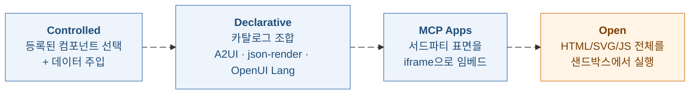
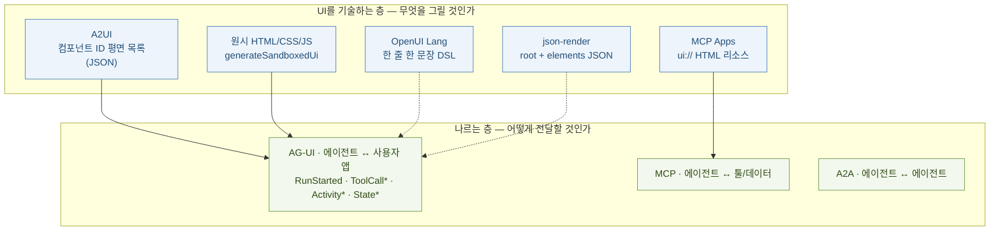
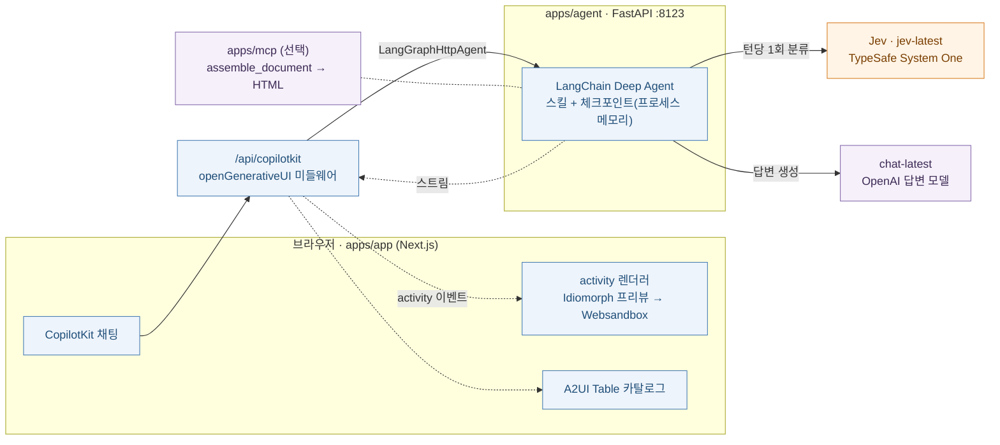
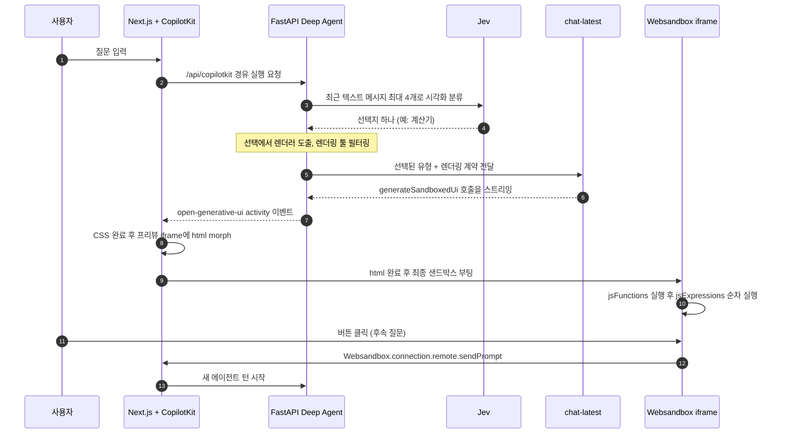
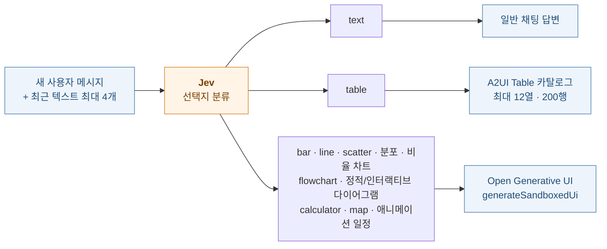
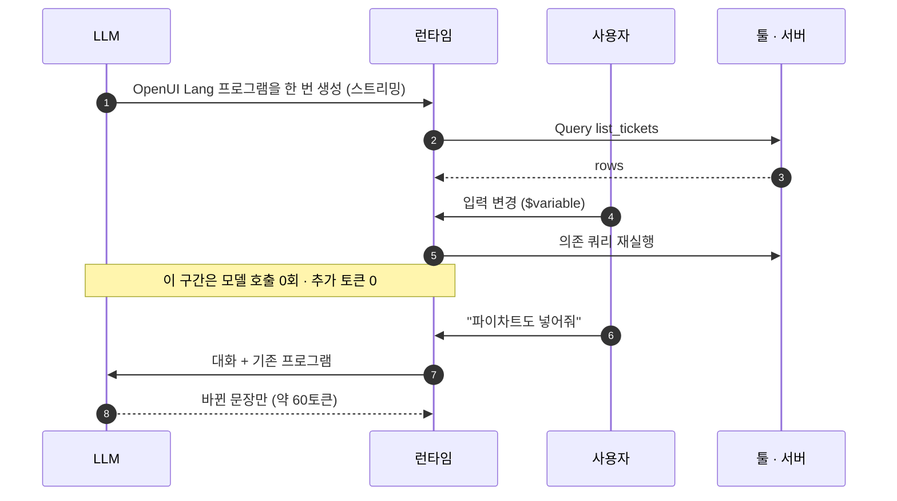
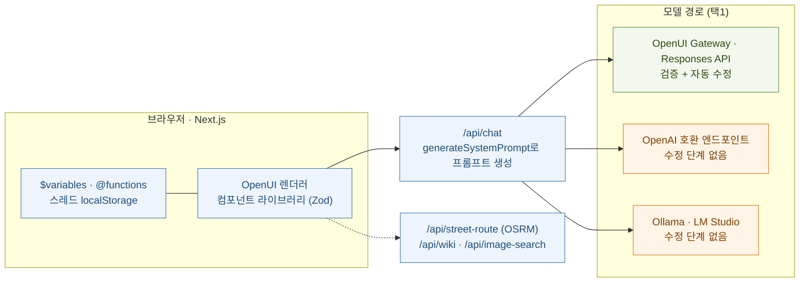
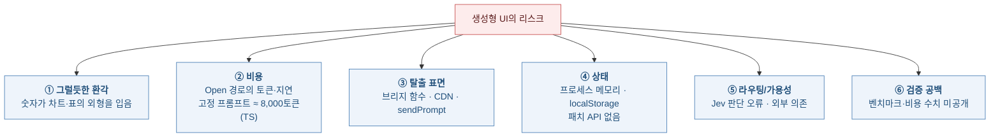
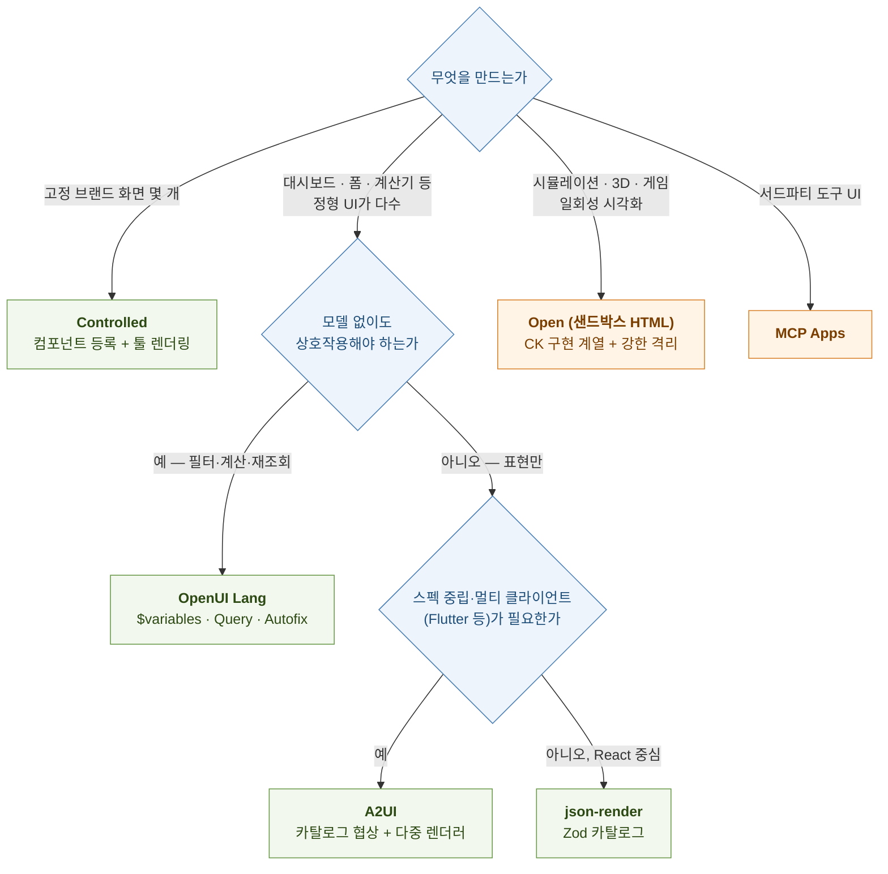

# OpenIntelligentUI 서베이

> 📊 **발표자료**: [open-intelligent-ui-presentation.pptx](./open-intelligent-ui-presentation.pptx)

<div class="doc-hero" markdown="1">
**이 글이 답하려는 질문** — OpenAI가 GPT-6와 함께 ChatGPT에 Intelligent UI를 내놓은 직후, 같은 이름의 오픈소스 재현 프로젝트가 **두 개** 나왔다. 둘은 이름만 같을 뿐 렌더링 포맷, 검증 방식, 상태 관리, 샌드박싱이 전혀 다르다. 그렇다면 각각은 무엇을 어떻게 만들고, "모델이 UI를 만든다"는 문제의 어느 지점을 서로 다르게 푸는가. 그리고 그 위의 생성형 UI 포맷(OpenUI Lang · A2UI · json-render · 원시 HTML)은 무엇이 다르며 언제 무엇을 골라야 하는가.

**3줄 요약**
1. `CopilotKit/OpenIntelligentUI`는 **모델이 HTML/CSS/JS를 직접 스트리밍하고 격리 iframe에서 실행**하는 쪽(스펙트럼의 Open 끝)이고, `thesysdev/open-intelligent-ui`는 **모델이 컴포넌트 라이브러리를 조합하는 DSL(OpenUI Lang)을 스트리밍**하는 쪽(Declarative)이다. 전자는 표현력, 후자는 토큰 효율·디자인 시스템 일치·모델 호출 없는 상호작용이 강점이다.
2. CopilotKit 구현은 답변 모델과 별개로 **Jev라는 빠른 결정 모델이 턴마다 "어떤 시각화·어떤 렌더러"를 먼저 고른다.** 포맷 결정을 생성 모델의 프롬프트에서 떼어내 타입이 있는 분류 문제로 바꾼 설계이며, 실패 시 조용히 대체하지 않고 턴을 실패시킨다.
3. 두 구현 모두 **시연용 레퍼런스**에 가깝다. 체크포인트가 프로세스 메모리이거나 스레드가 브라우저 localStorage에만 있고, 벤치마크·비용 수치는 공개되지 않았으며, 토큰 절감 같은 핵심 수치는 포맷 제작사 자체 측정이다. 골라 쓸 때는 "포맷이 곧 신뢰 경계"라는 점이 선택 기준이다.
</div>

<div class="toc" markdown="1">
<span class="toc-title">목차</span>
1. [왜 오픈 재현이 나왔나 — 문제와 이름 충돌](#sec1)
2. [생성형 UI 스펙트럼과 프로토콜 스택](#sec2)
3. [구현 A — CopilotKit OpenIntelligentUI](#sec3)
4. [Jev의 역할 — 포맷을 정하는 라우터](#sec4)
5. [구현 B — Thesys open-intelligent-ui와 OpenUI Lang](#sec5)
6. [두 구현 비교](#sec6)
7. [포맷 트레이드오프 — OpenUI Lang · A2UI · json-render · 원시 HTML](#sec7)
8. [한계와 리스크](#sec8)
9. [무엇을 고를 것인가](#sec9)
10. [참고문헌](#sec10)
11. [학습 퀴즈](#sec11)
</div>

---

## 1. 왜 오픈 재현이 나왔나 — 문제와 이름 충돌 {#sec1}

### 1.1 원본: ChatGPT Intelligent UI

OpenAI는 2026-10-07 GPT-6와 함께 Intelligent UI를 공개했다. 답변이 텍스트에 머무르지 않고 그래픽, 버튼, 폼, 차트, 작은 도구 형태의 상호작용 UI로 나온다. 구성은 둘이다. **네이티브 스트리밍 컴포넌트 라이브러리**와, 모델이 생성하는 동안 UI를 처리해 점진적으로 그려 주는 **컴파일러**다. 또 GPT-6는 이 라이브러리를 쓰는 법과 "언제 상호작용이 필요하고 언제 텍스트로 충분한가"를 학습했다고 밝힌다. [\[1\]](#ref1){:.cite} 2차 보도에 따르면 유료 플랜에 먼저 풀렸고 Free/Go에는 다음 날 열렸으며, 적용 범위는 Chat 경험에 한정된다. [\[2\]](#ref2){:.cite}

원본의 구조적 제약이 오픈 재현의 동기가 된다. CopilotKit은 이 기능이 폐쇄형이고, OpenAI 모델에서만 동작하며, ChatGPT 안에서만 쓸 수 있어 자기 제품에 가져올 API가 없다는 점을 출발점으로 삼는다. [\[10\]](#ref10){:.cite}

<div class="callout callout-warn" markdown="1">
**소싱 노트.** OpenAI 원문 페이지는 직접 열람이 막혀(403) 검색 결과로 노출된 본문과 2차 보도를 근거로 삼았다. "개발자용 컴포넌트 라이브러리 패키지는 공개되지 않았다"는 서술은 확인된 공개 자료에서 발견되지 않았다는 뜻이며, 공식 부재 선언이 아니다.
</div>

### 1.2 같은 이름, 다른 프로젝트

공개 직후 하루 간격으로 두 저장소가 같은 이름을 쓰며 나타났다. CopilotKit 블로그 글은 2026-10-09자이고 [\[10\]](#ref10){:.cite}, Thesys 저장소는 2026-10-08에 만들어졌다(GitHub API 조회). [\[13\]](#ref13){:.cite} CopilotKit 쪽은 기존 Open Generative UI 저장소가 개명된 것으로 보인다 — 문서가 "소스 저장소는 이제 `CopilotKit/OpenIntelligentUI`"라고 적고, 배포 설정의 서비스명과 패키지 식별자는 옛 이름을 그대로 유지한다고 명시한다. [\[7\]](#ref7){:.cite}[\[8\]](#ref8){:.cite}

| 항목 | **CopilotKit/OpenIntelligentUI** | **thesysdev/open-intelligent-ui** |
| :--- | :--- | :--- |
| 기반 | CopilotKit · AG-UI · LangChain Deep Agents | OpenUI(OpenUI Lang) |
| 모델이 내놓는 것 | 텍스트 / A2UI 표 / **HTML·CSS·JS** (`generateSandboxedUi`) | **OpenUI Lang 1.0** 프로그램 |
| 구성 | Next.js + FastAPI(Python) + 선택적 MCP + 디자인 시스템 패키지 | Next.js 단일 앱 (Node 24) |
| 라이선스 | MIT [\[3\]](#ref3){:.cite} | MIT [\[13\]](#ref13){:.cite} |
| 주석 | 개명 전 이력 있음 (2026-03 생성) | OpenAI와 무관하다고 README에 명시 |

<div class="callout callout-key" markdown="1">
**이 글의 용어 규칙.** 이하 "CK 구현"은 CopilotKit 저장소, "TS 구현"은 Thesys 저장소를 뜻한다. 두 저장소를 한 제품처럼 읽으면 비교가 성립하지 않는다.
</div>

---

## 2. 생성형 UI 스펙트럼과 프로토콜 스택 {#sec2}

생성형 UI는 단일 기술이 아니라 **에이전트가 쥐는 통제권의 스펙트럼**이다. CopilotKit은 이를 네 구간으로 나눈다. [\[12\]](#ref12){:.cite}



| 구간 | 에이전트의 역할 | 상한을 정하는 것 | 적합한 곳 (CopilotKit 설명) |
| :--- | :--- | :--- | :--- |
| Controlled | 등록된 컴포넌트와 인자만 고름 | 개발자가 출시한 컴포넌트 | 브랜드가 중요한 핵심 화면 |
| Declarative | 카탈로그 블록으로 UI 트리를 조립 | 카탈로그의 타입 스키마 | 롱테일 상호작용, 내부 도구 대시보드 |
| MCP Apps | 서드파티 UI를 호스트가 임베드 | iframe 샌드박스 | ChatGPT·Claude 같은 "슈퍼 호스트" |
| Open | 화면 전체(HTML 등)를 반환 | 샌드박스와 프롬프트 제약 | 일회성 시각화·소형 앱 |

같은 문서는 Open 구간이 다른 구간보다 오류가 잦고 예측하기 어려우며 느리고 비싸다고 평가하고, 한 제품 안에서 구간을 섞어 쓰라고 권한다. [\[12\]](#ref12){:.cite} 이 평가는 Open 구간을 주력으로 파는 벤더의 분류이므로 방향성 참고 이상으로 읽을 필요는 없다.

### 2.1 프로토콜 스택 — 무엇이 무엇 위에 얹히는가

혼동이 가장 잦은 지점이다. **AG-UI는 UI 명세가 아니라 에이전트와 사용자 앱 사이의 이벤트 전송 프로토콜**이다. A2UI와 MCP Apps는 UI를 기술하는 쪽이고, AG-UI는 그것을 나르는 쪽이다. [\[26\]](#ref26){:.cite}[\[12\]](#ref12){:.cite}



- **AG-UI** 이벤트는 수명주기(`RunStarted`/`RunFinished`/`RunError`), 텍스트(`TextMessage*`), 툴 호출(`ToolCallStart`/`Args`/`End`/`Result`), 상태(`StateSnapshot`/`StateDelta`), 액티비티(`ActivitySnapshot`/`ActivityDelta`) 등으로 구성된다. [\[27\]](#ref27){:.cite} 점선 연결(OpenUI Lang, json-render)은 AG-UI가 전송을 보장하는 것이 아니라 어떤 전송 위에도 얹을 수 있음을 뜻한다 — OpenUI는 AG-UI 통합 페이지를 따로 둔다. [\[20\]](#ref20){:.cite}
- **A2UI**(Google, Apache-2.0)는 에이전트가 UI 의도를 JSON으로 보내면 클라이언트가 **자체 네이티브 컴포넌트**로 그리는 선언형 포맷이다. 실행 가능한 코드가 아니라 데이터이며, 에이전트는 클라이언트 카탈로그에 있는 컴포넌트만 요청할 수 있다. 전송은 A2A와 AG-UI 등을 쓴다. [\[22\]](#ref22){:.cite} v0.9(2026-04-17)는 React 렌더러, 클라이언트 정의 함수, 클라이언트-서버 데이터 동기화, 카탈로그에서 시스템 프롬프트를 만드는 에이전트 SDK를 추가했다. [\[23\]](#ref23){:.cite}
- **MCP Apps**는 MCP 서버가 툴 정의에 `_meta.ui.resourceUri`(`ui://` 리소스)를 선언하고, 호스트가 그 HTML을 샌드박스 iframe에 렌더링하며, 앱과 호스트는 `postMessage` 위의 JSON-RPC 방언으로 통신하는 구조다. [\[28\]](#ref28){:.cite}

---

## 3. 구현 A — CopilotKit OpenIntelligentUI {#sec3}

### 3.1 구성 요소

| 경로 | 역할 |
| :--- | :--- |
| `apps/app` | Next.js 프런트엔드 + `/api/copilotkit` 런타임 라우트 |
| `apps/agent` | FastAPI(:8123) + LangGraph + Deep Agent, 툴·프롬프트·스킬 |
| `apps/mcp` | 선택적 독립 MCP 서버 — 스킬·프롬프트·`assemble_document`(HTML을 텍스트로 반환) |
| `packages/design-system` | 공용 테마·SVG 클래스·폼 스타일 |

Turborepo/pnpm 모노레포이며 Node 22+, Python 3.12+, uv가 필요하고 `make setup` → `make dev`로 올린다. [\[3\]](#ref3){:.cite} 에이전트는 `create_deep_agent`에 CopilotKit 미들웨어와 `BoundedMemorySaver(max_threads=200)` 체크포인터를 붙여 구성한다. [\[4\]](#ref4){:.cite}



에이전트를 교체할 수 있다는 점이 구조의 핵심 장점이다. CopilotKit은 에이전트가 AG-UI로 프런트엔드에 연결되므로 LangChain 에이전트를 Mastra, Google ADK, Microsoft Agent Framework로 바꿔도 UI는 그대로라고 설명한다. [\[10\]](#ref10){:.cite} 다만 실제로 확인된 것은 `LangGraphHttpAgent` 경로뿐이고, 다른 프레임워크 조합은 블로그의 주장이다.

### 3.2 요청 한 번의 흐름



흐름의 핵심은 세 가지다.

**① 렌더러 선택이 모델 호출 앞에 있다.** Jev가 먼저 고르고, 그 결과에서 렌더러가 *도출*되며, 답변 모델에는 선택된 유형과 해당 렌더링 계약만 전달된다. 미들웨어는 CopilotKit이 주입한 렌더링 툴을 걸러 내므로 다른 렌더러 툴은 모델에 보이지 않는다. [\[5\]](#ref5){:.cite}

**② 파라미터 순서가 곧 UX 설계다.** `generateSandboxedUi`의 인자는 `initialHeight → placeholderMessages → css → html → jsFunctions → jsExpressions` 순으로 스트리밍된다. CSS가 먼저 와야 스타일 없는 UI가 보이지 않고, 표현식이 마지막에 와야 사용자가 동작이 하나씩 붙는 모습을 본다. [\[6\]](#ref6){:.cite} html이 스트리밍되는 동안은 Idiomorph로 프리뷰 iframe을 깜빡임 없이 갱신하고, html이 끝나면 websandbox iframe을 부팅해 공용 디자인 CSS와 CDN importmap을 주입한 뒤 `jsFunctions`, 각 `jsExpression` 순으로 실행한다. [\[6\]](#ref6){:.cite}

**③ 후속 질문은 패치가 아니라 새 턴이다.** 이전 출력은 별개의 스냅샷으로 남고, 교차 호출 DOM 패치 API는 없으며, iframe 내부 컨트롤 상태는 에이전트 메모리에 자동 동기화되지 않는다. 그래서 "이 시나리오로 질문하기" 같은 명시적 동작이 현재 선택값을 `sendPrompt`에 직접 담아야 한다. [\[4\]](#ref4){:.cite}[\[7\]](#ref7){:.cite}

### 3.3 샌드박스와 브리지

| 항목 | 내용 | 출처 |
| :--- | :--- | :--- |
| 격리 | 생성 코드는 same-origin 접근 없는 iframe에서 실행. 스토리지·호스트 API 접근 불가 | [\[4\]](#ref4){:.cite} |
| 호스트 노출 함수 | `sendPrompt({ text })`, HTTPS 전용 `openLink({ url })`. Zod로 검증 | [\[4\]](#ref4){:.cite}[\[6\]](#ref6){:.cite} |
| 사전 주입 라이브러리 | `three`, `gsap`, `d3`, `chart.js/auto` (importmap). 이 외 라이브러리는 승인된 CDN만 | [\[6\]](#ref6){:.cite}[\[10\]](#ref10){:.cite} |
| 실행 제약 | JS 채널은 classic script — 최상위 `await` 불가, 비동기 import는 async 함수 안에서 | [\[4\]](#ref4){:.cite} |
| 높이 | 리사이즈 메시지를 검증·제한한 뒤 iframe 높이에 반영 | [\[4\]](#ref4){:.cite} |
| 테마 | CSS 변수(`--color-background-primary` 등)와 `.c-purple` 같은 SVG 클래스로 디자인 계약 전달 | [\[6\]](#ref6){:.cite} |

격리의 실질적 안전 경계는 iframe이고, **호스트 페이지에서 도는 브리지 함수가 가장 약한 고리**다. CopilotKit 문서도 이 표면을 작고 명시적으로 유지하라고 권고하며, 데모의 산술 평가기가 기본 산술 문자 밖의 입력을 거부하는 예를 든다. [\[11\]](#ref11){:.cite}

### 3.4 환각을 줄이는 장치들

"UI의 형태를 한 숫자"는 텍스트보다 더 믿음직해 보인다. 문서는 이 문제를 프롬프트 규칙과 툴 설계로 다룬다.

- `query_data`는 번들 CSV의 **모든 행**을 `is_sample: true`, `query_applied: false`와 함께 돌려준다. 자연어 질의를 적용하지 않으며 실제 데이터 연결이 아니다. [\[4\]](#ref4){:.cite}[\[7\]](#ref7){:.cite}
- 사용자 제공 값·검색된 근거·계산 결과·예시 가정을 구분해 라벨링하고, 필수 근거가 없으면 지어내지 말고 입력을 요청하도록 한다. [\[7\]](#ref7){:.cite}
- 지도는 Leaflet + USGS 지형 타일을 쓰며, 이동 경로 선은 방향 API 데이터가 없는 한 **예시일 뿐 검증된 주행 경로가 아니다.** 마일리지·소요 시간을 지어내지 말라는 규칙이 있다. [\[5\]](#ref5){:.cite}

### 3.5 키·상태·배포

- **BYOK.** 방문자가 채팅 헤더에서 OpenAI 키와 Jev 키를 넣으면, Next.js 런타임이 `x-openai-api-key`, `x-jev-api-key` 헤더만 에이전트로 전달한다. Python ASGI 미들웨어가 헤더를 떼어 내 스트리밍 요청 범위로만 자격증명을 한정하고, 체크포인트 ID는 자격증명별로 분리되며, **두 키가 모두 있어야 하고 하나만 있을 때 서버 시크릿으로 폴백하지 않는다.** LangSmith 호스티드 트레이싱은 BYOK 요청에서 꺼진다. 다만 서버가 키를 수신하는 것은 불가피하므로 HTTPS와 헤더 로깅 금지가 전제다. [\[8\]](#ref8){:.cite}
- **상태.** 체크포인트는 프로세스 메모리다. 배포 설정은 서비스당 1~3 인스턴스 스케일을 선언하지만, 재시작이나 스케일 아웃 시 대화 상태가 사라지거나 갈라질 수 있고 프런트엔드의 레이트 리미터도 프로세스 로컬이다. [\[8\]](#ref8){:.cite}
- **텔레메트리.** 설치당 최대 두 개의 익명 이벤트를 보내며 프롬프트·답변·키·모델명은 포함하지 않는다. `DO_NOT_TRACK=1` 등으로 끈다. [\[9\]](#ref9){:.cite}
- **검증.** 헬스 체크가 통과해도 제공자 인증·스트리밍·브라우저 동작은 검증되지 않으며, 별도 출시 절차가 실제 제공자 스모크 테스트를 요구한다. [\[3\]](#ref3){:.cite}[\[8\]](#ref8){:.cite}

---

## 4. Jev의 역할 — 포맷을 정하는 라우터 {#sec4}

> Jev와 결정 모델 자체(System One의 질문 프리미티브, 보정된 확률, 학습·평가 방식)는 자매 글에서 깊이 다룬다. 여기서는 OpenIntelligentUI 안에서의 **역할**만 정리한다.

### 4.1 무엇을 입력받고 무엇을 내놓는가

Jev(`jev-latest`)는 TypeSafe의 System One API를 통해 **새 사용자 메시지마다 타입이 있는 표현 결정 하나**를 만든다. 입력은 최근 사용자/어시스턴트 텍스트 메시지 최대 4개(각 6,000자 상한)이고, API 키·시스템 지시·원시 툴 출력·생성된 툴 코드는 받지 않는다. [\[5\]](#ref5){:.cite} System One 자체는 `state`와 질문 목록을 받아 `choice`/`score`/`noul` 프리미티브별로 답과 확률·신뢰도를 돌려주는 API다. [\[21\]](#ref21){:.cite}



### 4.2 설계가 보여 주는 것

- **렌더러는 선택에서 파생된다.** 검증된 선택에서 렌더러를 도출하므로 "표인데 샌드박스 렌더러" 같은 모순 조합이 만들어지지 않는다. 선택은 사용자 메시지 ID와 함께 스레드 상태에 저장되어 툴 연속 호출 중 재사용되고, 새 사용자 메시지는 대화 맥락과 함께 다시 분류된다. [\[5\]](#ref5){:.cite}
- **실패는 실패로 드러낸다.** Jev 인증 실패, 잘못된 선택, 타임아웃은 재시도 가능한 오류로 턴을 실패시킨다. Jev가 결정한 것처럼 꾸미는 조용한 폴백은 없다. [\[5\]](#ref5){:.cite} 문서는 라우팅이 모델의 판단이지 객관적 최적을 보장하지 않는다고 스스로 명시한다. [\[5\]](#ref5){:.cite}
- **기본 표 하나만 선언형이다.** 현재 선언형(A2UI) 경로로 가는 것은 기본 표뿐이고 나머지 시각화는 전부 Open 경로다. 즉 이 구현의 실질은 "표는 안전한 카탈로그로, 나머지는 자유 코드로"라는 2단 구조다. [\[5\]](#ref5){:.cite}

### 4.3 왜 생성 모델이 아니라 별도 결정 모델인가 (분석)

아래는 문서가 직접 밝힌 이유가 아니라, 공개된 설계 사실에서 도출한 해석이다. 문서가 밝힌 것은 "Jev가 표현을 고른다"와 "답변 모델에는 선택된 유형과 계약만 준다"는 구조뿐이다.

| 관점 | 생성 모델이 직접 고르게 할 때 | 별도 결정 모델에 맡길 때 |
| :--- | :--- | :--- |
| 프롬프트 | 모든 렌더러의 계약이 한 프롬프트에 공존 | 답변 모델은 선택된 렌더러의 계약만 받음 (확인됨) |
| 출력 형태 | 자유 서술이나 툴 선택에서 암묵적으로 결정 | 타입이 있는 선택지 (확인됨) |
| 불일치 | 유형과 렌더러가 어긋날 수 있음 | 렌더러를 선택에서 도출 (확인됨) |
| 비용/지연 | 추가 호출 없음 | 턴마다 호출 1회 추가 — 지연·비용 수치는 공개되지 않음 |
| 의존성 | 답변 모델 하나 | TypeSafe 키와 가용성에 결합 (확인됨) |

핵심 이점은 **관심사 분리와 결정의 타입화**이고, 대가는 추가 홉과 외부 의존성이다. 결정 모델 자체의 성질은 [자매 글](../2026-10-23-jev-decision-models/jev-decision-models-blog)을 참고한다.

---

## 5. 구현 B — Thesys open-intelligent-ui와 OpenUI Lang {#sec5}

### 5.1 OpenUI Lang의 문법

OpenUI Lang은 한 줄에 한 문장, `identifier = Expression` 형태의 줄 지향 언어다. 인자는 위치 기반이고, 함수와 액션에는 `@` 접두어가 필요하며(`Action([...])`만 예외), 진입점은 `root` 문장이다. 정의 전에 이름을 참조할 수 있고(포워드 참조), 같은 이름이 중복되면 나중 것이 이긴다. [\[16\]](#ref16){:.cite} 짧은 예로 `root = Stack([chart])`가 문서에 나온다. [\[15\]](#ref15){:.cite} 같은 UI를 JSON으로 쓸 때 반복되는 `"component"`, `"props"` 키가 사라지는 것이 토큰 절감의 원천이다. [\[15\]](#ref15){:.cite}

문서의 티켓 트래커 예제에서 발췌한 문장들이다. [\[17\]](#ref17){:.cite}

```text
$title = ""
$priority = "medium"
tickets = Query("list_tickets", {}, {rows: []})
createResult = Mutation("create_ticket", {title: $title, priority: $priority})
submitBtn = Button("Create", Action([@Run(createResult), @Run(tickets)]), "primary")
tbl = Table([Col("Title", tickets.rows.title), Col("Priority", tickets.rows.priority)])
```

### 5.2 생성과 실행의 분리



문서의 요지는 모델이 **배선만 한 번 생성하고 런타임이 실행**한다는 것이다. 클릭·필터·폼 제출은 모델 호출 없이 처리되므로 토큰도 모델 지연도 없다. `$variables`는 반응형 상태이며 입력이 바뀌면 그 변수를 쓰는 쿼리가 다시 실행되고, `@Run`이 쿼리·뮤테이션을 트리거하며 `@Reset`이 상태를 비운다. 후속 요청("차트 추가")에서는 모델이 변경된 문장만 출력하고 파서가 기존 프로그램에 병합한다. 문서의 대략적 수치는 전체 20줄 프로그램 약 400토큰, 2~3줄 패치 약 60토큰이다. [\[17\]](#ref17){:.cite}

TS 구현은 이를 데모 제품 수준으로 끌어올린다. 입력은 `$variables`에 바인딩하고, 화면에 보이는 값은 `@functions`로 계산하며, 버튼은 `@Set`으로 변수를 바꾼다. 폼을 어시스턴트에게 되돌려 보내는 대신 **페이지 안에서 동작하는 작은 도구**를 만드는 것이 프롬프트 규칙이다. 범용 `@functions`가 59개이고(리스트·숫자·텍스트·색·날짜·대시보드용 `@GroupBy`, `@Pivot`, `@MovingAvg` 등), 잘못된 인자는 null로 평가된다. 예: `@Each(@Range(0, $years + 1), "y", {year: y, balance: $p * @Pow(1 + $r / 100, y)})`. [\[13\]](#ref13){:.cite}

### 5.3 구성



- **프롬프트.** `/api/chat`이 서버에서 컴포넌트 라이브러리로부터 시스템 프롬프트를 생성해 Gateway의 Responses API로 보내고 스트림을 브라우저로 중계한다. Gateway가 앱의 라이브러리에 맞춰 OpenUI Lang을 검증·수정한다. `SearchImage`가 스스로 사진을 찾으므로 검색 툴은 모델에 넘기지 않는다. 기본 모델은 `openai/gpt-6.1-sol`(`THESYS_MODEL`), 키는 서버 전용 `THESYS_API_KEY`다. [\[13\]](#ref13){:.cite}
- **Gateway.** 채팅 완성과 Responses 두 엔드포인트를 제공하며 스트리밍 중 검증하고, 공급자 장애 시 다른 공급자로 재시도하고, 토큰은 공급자 가격 그대로 과금한다고 설명한다. [\[19\]](#ref19){:.cite} 모델을 직접 호출하는 경우를 위한 Autofix는 생성이 끝난 뒤 **완성본**을 검사한다(`unknown-component`, `missing-required`, `type-mismatch`, `incomplete`, `missing-root` 등). 결과는 `already_valid`/`fixed`/`fix_failed`이고 시도는 최대 2회, 생성 100,000자·이전 맥락 20턴/8,000자 상한이 있다. [\[18\]](#ref18){:.cite}
- **직접 경로.** `LLM_BASE_URL` 등으로 OpenAI 호환 API를 쓰거나 Ollama(기본 `qwen3.8:27b`)를 쓰면 Chat Completions를 Responses 형태 이벤트로 중계하고, **출력은 쓴 그대로 렌더링되며 수정 단계가 없다.** 더 큰 모델이 낫다는 것이 README의 권고다. [\[13\]](#ref13){:.cite}
- **함정.** 프롬프트가 약 8,000토큰인데 Ollama 기본 컨텍스트는 4,096이라 프롬프트가 *조용히 잘려* 출력이 깨진다. 32K 컨텍스트로 올려야 한다. [\[13\]](#ref13){:.cite}
- **컴포넌트 범위.** 레이아웃, 입력, `Chart`(막대·선·면적·파이·도넛·산점), `Map`(MapLibre GL), `Table`, `Math`(KaTeX), `Svg`, 그리고 샌드박스 iframe에서 HTML을 돌리는 `HtmlView`까지 있다. 즉 선언형을 기본으로 하되 **원시 HTML 탈출구**를 하나 남긴 설계다. [\[13\]](#ref13){:.cite}
- **서버 엔드포인트.** `/api/street-route`는 공개 OSRM 데모 서버를 캐시해 쓰며 주행 개요용이고 직선 폴백이 표시된다. `/api/wiki`, `/api/image-search`는 위키백과/위키미디어 커먼즈 사진을 찾는다. [\[13\]](#ref13){:.cite}
- **영속성.** 스레드와 사용자가 입력·체크한 값까지 브라우저 localStorage에 저장된다. [\[13\]](#ref13){:.cite}
- **개발 보조.** 개발 전용 `/gallery`는 API 키 없이 16개 예제와 대시보드를 손으로 쓴 프로그램으로 렌더링하며, `scripts/bench`는 16개 예제 프롬프트와 8개 대시보드 프롬프트를 임의의 OpenAI 호환 모델에 돌려 파서로 검사하고 스크린샷을 남긴다. [\[13\]](#ref13){:.cite}

---

## 6. 두 구현 비교 {#sec6}

| 비교 축 | **CK 구현** (CopilotKit) | **TS 구현** (Thesys) |
| :--- | :--- | :--- |
| 렌더링 포맷 | 툴 인자의 HTML/CSS/JS + A2UI 표 + 네이티브 컴포넌트 | OpenUI Lang 1.0 (+ `HtmlView` 탈출구) |
| 검증 | 포맷 검증 없음. **격리(iframe)와 Zod 검증 브리지**로 방어. A2UI 표는 ≤12열 · ≤200행, 행 너비 불일치 거부 [\[5\]](#ref5){:.cite} | **Gateway의 검증·자동 수정**, 파서가 잘못된 부분 제거. 직접 경로는 수정 없음 [\[13\]](#ref13){:.cite}[\[15\]](#ref15){:.cite} |
| 답변 모델 | `chat-latest` (OpenAI 이동 별칭), `claude-*`/`gpt-*` 재정의 가능 [\[5\]](#ref5){:.cite}[\[8\]](#ref8){:.cite} | 기본 `openai/gpt-6.1-sol`, 임의 OpenAI 호환 모델, Ollama [\[13\]](#ref13){:.cite} |
| 라우터 | **Jev** (`jev-latest`) — 턴마다 시각화/렌더러 선택 | 문서상 별도 라우터 없음. 단일 경로에서 모델이 라이브러리를 조합 |
| 상호작용 | iframe 내부 JS는 로컬 동작, 후속은 `sendPrompt`로 **새 턴** | `$variables`·`@functions`가 로컬 계산. 쿼리는 런타임이 실행, 모델 왕복 없음 |
| 상태 | LangGraph 체크포인트(프로세스 메모리, 최대 200 스레드) | 브라우저 상태 + localStorage 스레드 |
| 샌드박싱 | 모든 Open 출력이 Websandbox iframe. 라이브러리는 승인 CDN | 대부분은 샌드박스 불필요(선언형). `HtmlView`만 iframe |
| 키 | 서버 시크릿 또는 방문자 BYOK(메모리 보관, 체크포인트 제외, LangSmith 비활성) | 서버 `THESYS_API_KEY` 또는 `LLM_API_KEY` 환경 변수 |
| 영속성 | 내구성 없음 (재시작 시 유실 가능) | localStorage만 (기기 간 공유 없음) |
| 에이전트 | Deep Agent (AG-UI로 교체 가능하다고 주장) | 문서상 별도 에이전트 루프 없음. 프롬프트 생성 + 스트림 중계 |
| 테마 | CSS 변수로 라이트/다크 계약 전달 [\[6\]](#ref6){:.cite} | 컴포넌트는 두 토큰 세트를 갖지만 채팅은 **라이트 전용** [\[13\]](#ref13){:.cite} |
| 스택 | Next.js · FastAPI · LangGraph · uv · Turborepo | Next.js · React · Zod · MapLibre · KaTeX · Vitest · Playwright |

<div class="callout callout-key" markdown="1">
**한 줄 요약.** CK 구현은 "모델에게 화면을 통째로 맡기고 가둔다"이고, TS 구현은 "모델에게 화면을 *기술*하게 하고 런타임이 실행한다"이다. 전자는 격리가 보안이고, 후자는 **어휘의 한정**이 보안이다.
</div>

---

## 7. 포맷 트레이드오프 — OpenUI Lang · A2UI · json-render · 원시 HTML {#sec7}

| 축 | OpenUI Lang | A2UI | json-render | 원시 HTML/CSS/JS |
| :--- | :--- | :--- | :--- | :--- |
| 표현 | 줄 지향 DSL, 위치 인자 [\[16\]](#ref16){:.cite} | 컴포넌트 ID로 참조하는 **평면 목록** JSON [\[22\]](#ref22){:.cite} | `root` + `elements` 맵 JSON, Zod 카탈로그 [\[24\]](#ref24){:.cite} | 텍스트로 된 완결 프로그램 |
| 스트리밍 | 줄 단위 파싱, 포워드 참조 허용 [\[16\]](#ref16){:.cite} | 평면 구조라 점진 생성·렌더링에 적합 [\[22\]](#ref22){:.cite} | SpecStream 컴파일러로 부분 결과 렌더 [\[24\]](#ref24){:.cite} | 파라미터 순서 + DOM morph [\[6\]](#ref6){:.cite} |
| 토큰(제작사 자체 측정) | 기준 1x (7개 시나리오 합 4,800) [\[14\]](#ref14){:.cite} | OpenUI 비교표 기준 3x [\[14\]](#ref14){:.cite} | 합 10,180 (OpenUI가 52.8% 적음), 비교표 3x [\[14\]](#ref14){:.cite} | OpenUI 비교표가 CK Open GenUI를 4x로 평가 [\[14\]](#ref14){:.cite} |
| 안전 모델 | 라이브러리·함수 어휘 한정, 알 수 없는 것은 오류 코드 [\[16\]](#ref16){:.cite} | 데이터일 뿐 코드 아님, 카탈로그 밖 요청 불가 [\[22\]](#ref22){:.cite} | 카탈로그·액션 밖 사용 불가 [\[24\]](#ref24){:.cite} | **임의 코드** → 격리 필수 |
| 디자인 시스템 충실도 | 높음 (라이브러리가 곧 시스템) | 높음 (클라이언트 네이티브 컴포넌트) | 높음 (shadcn/ui 36종 등 사전 제공) | 낮음 — CSS 변수·디자인 스킬로 *유도*할 뿐 |
| 모델 없는 상호작용 | `$variables`·`@functions`·`Query` | 클라이언트 정의 함수, 데이터 동기화 (v0.9) [\[23\]](#ref23){:.cite} | 선언된 액션 | 내부 JS는 자유, 외부 반영은 브리지 |
| 표현 한계 | 라이브러리 + `HtmlView` | 카탈로그 | 카탈로그 | 사실상 없음 (Three.js·게임) |

토큰 수치는 OpenUI 저장소의 자체 측정이다. tiktoken(GPT-5 인코더)으로 7개 시나리오를 합산하면 OpenUI Lang 4,800, Vercel JSON-Render 10,180(−52.8%), Thesys C1 JSON 9,948(−51.7%)이고, 단일 시나리오 최대 절감(−67.1%)이 "최대 67%" 문구의 출처다. [\[14\]](#ref14){:.cite}

<div class="callout callout-warn" markdown="1">
**벤더 수치 주의.** 위 토큰·지연 비교는 OpenUI 제작사가 자기 포맷에 유리한 시나리오로 측정한 값이며, 같은 README의 비교표는 경쟁 구현(CopilotKit Open GenUI 4x, 부분 스트리밍)을 평가한다. 방향(DSL이 키 반복 JSON보다 짧다)은 구조상 납득되지만, 정확한 배율은 자기 프롬프트로 재측정해야 한다. 또 토큰 절감이 곧 품질이나 정확도를 의미하지는 않는다 — 모델이 낯선 DSL을 얼마나 잘 쓰는가는 별개의 문제다.
</div>

### 7.1 해석

1. **통제 ↔ 표현력은 한 축이다.** 선언형 셋(OpenUI Lang · A2UI · json-render)은 "카탈로그에 있는 것만 말할 수 있다"는 점에서 같고, 원시 HTML은 "무엇이든 말할 수 있다"는 점에서 다르다. 위험 표면도 정확히 그 순서로 커진다.
2. **셋의 차이는 직렬화와 런타임이다.** A2UI는 *프로토콜*(전송·카탈로그 협상까지 포함), json-render는 *Zod 카탈로그 + JSON 스펙 + 다중 렌더러*, OpenUI는 *DSL + 반응형 런타임 + 게이트웨이* 묶음에 가깝다. 같은 층위의 대체재가 아니다.
3. **수렴 조짐.** OpenUI 저장소에는 A2UI v1.0 클라이언트 패키지(`a2ui`)가 있어 OpenUI Lang 페이로드를 A2UI 위에서 쓸 수 있고 [\[14\]](#ref14){:.cite}, json-render는 "Jev (Experimental)"라는 이름의 조합 경로(`experimental_composeSpec`)를 내놓았다. [\[24\]](#ref24){:.cite} 포맷 간 경계가 아직 유동적이라는 신호다. 이 경로는 미출시·실험 단계로 표기돼 있고, 여기의 Jev가 TypeSafe의 Jev와 같은 모델인지는 해당 문서만으로는 확인되지 않는다.
4. **json-render 맥락.** Vercel Labs 프로젝트로 2026-01 공개, Apache-2.0이며 Vercel 측이 스스로 초기 연구 프로토타입에 가깝다고 설명하는 것으로 보도됐다. [\[25\]](#ref25){:.cite}

---

## 8. 한계와 리스크 {#sec8}



1. **그럴듯한 환각.** UI는 텍스트보다 권위 있어 보인다. 두 구현 모두 이를 프롬프트와 툴 규칙으로 완화한다(샘플 데이터 라벨, 근거 없는 현재 데이터 금지, 지도 경로의 예시 표기). [\[7\]](#ref7){:.cite}[\[5\]](#ref5){:.cite} 그러나 규칙은 *모델이 지킬 때* 유효하며, 어떤 렌더러도 차트의 숫자가 사실인지는 검증하지 않는다.
2. **토큰·지연 비용.** CK 구현의 Open 경로는 CSS·HTML·JS 전체를 생성한다. 벤더 분류도 이 경로가 가장 비싸다고 인정한다. [\[12\]](#ref12){:.cite} TS 구현은 출력은 짧지만 시스템 프롬프트가 약 8,000토큰이라 턴마다 고정 입력 비용이 있다. [\[13\]](#ref13){:.cite} 두 프로젝트 모두 지연·비용 벤치마크 수치를 공개하지 않았고 [\[10\]](#ref10){:.cite}, TS의 벤치마크 스크립트는 파서 통과 여부와 스크린샷 점검용이다. [\[13\]](#ref13){:.cite}
3. **샌드박스 탈출 표면 (분석).** iframe은 same-origin 접근을 막지만, 호스트가 노출한 `sendPrompt`는 *생성된 코드가 에이전트에게 말을 거는 통로*다. 문서는 "로드·타이머·입력 변경 시 자동 전송 금지, 명확한 라벨의 사용자 클릭만"을 지침으로 두는데 [\[7\]](#ref7){:.cite}, 이는 코드 수준 강제가 아니라 모델에게 주는 규칙이라 프롬프트 인젝션 관점에서는 검토 대상이다. 또 CDN 허용 목록은 공급망 의존이다. [\[10\]](#ref10){:.cite}
4. **상태와 편집.** 이전 출력은 스냅샷이고 패치 API가 없으므로 "이 부분만 바꿔 줘"는 새 생성이다(CK). [\[7\]](#ref7){:.cite} OpenUI Lang의 문장 단위 병합은 이 비용을 줄이는 구조적 이점이다(TS). [\[17\]](#ref17){:.cite} 반대로 CK의 체크포인트는 프로세스 메모리라 스케일 아웃에 취약하다. [\[8\]](#ref8){:.cite}
5. **라우팅과 가용성.** Jev는 판단이므로 틀릴 수 있고, 실패는 턴 실패로 이어진다. [\[5\]](#ref5){:.cite} 즉 UI 품질이 제3자 API 가용성에 묶인다.
6. **기타 제약.** TS 구현의 채팅은 라이트 테마 전용이고, Ollama 컨텍스트 함정이 있으며, 직접 경로에는 자동 수정이 없다. [\[13\]](#ref13){:.cite} 주행 경로는 공개 OSRM 데모 서버에 기대고 있어 서비스 용도로는 부적합하다. [\[13\]](#ref13){:.cite} CK 쪽 BYOK는 서버가 키를 수신하므로 운영자를 신뢰할 수 있어야 한다. [\[8\]](#ref8){:.cite}

---

## 9. 무엇을 고를 것인가 {#sec9}



| 상황 | 권장 | 근거 |
| :--- | :--- | :--- |
| 자사 디자인 시스템 충실도가 최우선 | 선언형(OpenUI Lang · A2UI · json-render) | 카탈로그가 곧 허용 어휘 |
| 모델 호출 없이 계산·필터·재조회가 필요 | OpenUI Lang | 생성/실행 분리, 문장 단위 패치 [\[17\]](#ref17){:.cite} |
| 3D·시뮬레이션·게임 같은 자유 형식 | Open + 강한 격리 | 선언형 어휘로 표현 불가 [\[12\]](#ref12){:.cite} |
| 여러 클라이언트(Flutter·Angular·Lit) | A2UI | 다중 렌더러·전송 선택지 [\[22\]](#ref22){:.cite} |
| 기존 AG-UI/LangGraph 에이전트에 붙이기 | CK 구현 계열 | `/api/copilotkit` + 활동 렌더러 구조 [\[4\]](#ref4){:.cite} |
| 에이전트 없이 프롬프트 + 스트림 중계로 빠르게 | TS 구현 계열 | 단일 앱, `/gallery`로 키 없이 시작 [\[13\]](#ref13){:.cite} |
| 로컬 모델만 사용 | TS 구현 + 큰 모델 + 32K 컨텍스트 | 수정 단계 부재를 모델 크기로 상쇄 [\[13\]](#ref13){:.cite} |

**실무 권고 세 가지.**

1. **한 포맷으로 통일하려 하지 말고 구간을 섞는다.** CopilotKit도 한 제품에서 구간을 혼합하라고 권한다. [\[12\]](#ref12){:.cite} 두 구현이 이미 그렇다 — CK 구현은 표만 A2UI로, TS 구현은 선언형을 기본으로 하고 `HtmlView`를 남겼다.
2. **격리를 포맷 선택의 *결과*로 설계한다.** 선언형을 쓰면 어휘 검증이, Open을 쓰면 iframe·브리지 최소화·CDN 허용 목록이 보안의 중심이 된다.
3. **라우팅을 분리하되 폴백을 의도적으로 설계한다.** Jev식 선분류는 프롬프트를 단순하게 하지만 외부 의존과 추가 지연을 만든다. 실패 시 "턴 실패"(CK 구현)로 둘지, 텍스트 답변으로 낮출지는 제품 결정이다.

---

## 10. 참고문헌 {#sec10}

> 본문의 `[N]`을 누르면 해당 항목으로 이동한다. GitHub 저장소·문서는 2026-10-23 기준으로 열람했다.

**원본 제품 (OpenAI) 및 보도**

<span id="ref1"></span>**[1]** GPT-6 and Intelligent UI for everyone — OpenAI (2026-10-07, 본문은 검색 결과 노출분 기준) · [https://openai.com/index/gpt-6-for-everyone/](https://openai.com/index/gpt-6-for-everyone/)

<span id="ref2"></span>**[2]** OpenAI Rolls Out GPT-6 and Intelligent UI in ChatGPT — Let's Data Science (2차 보도) · [https://letsdatascience.com/news/openai-brings-gpt-6-and-intelligent-ui-to-chatgpt-4f0d797c](https://letsdatascience.com/news/openai-brings-gpt-6-and-intelligent-ui-to-chatgpt-4f0d797c)

**구현 A — CopilotKit OpenIntelligentUI (1차 저장소 · 문서)**

<span id="ref3"></span>**[3]** CopilotKit/OpenIntelligentUI README — GitHub · [https://github.com/CopilotKit/OpenIntelligentUI](https://github.com/CopilotKit/OpenIntelligentUI)

<span id="ref4"></span>**[4]** Architecture — CopilotKit/OpenIntelligentUI `docs/architecture.md` · [https://github.com/CopilotKit/OpenIntelligentUI/blob/main/docs/architecture.md](https://github.com/CopilotKit/OpenIntelligentUI/blob/main/docs/architecture.md)

<span id="ref5"></span>**[5]** Visualization routing — CopilotKit/OpenIntelligentUI `docs/visualization-routing.md` · [https://github.com/CopilotKit/OpenIntelligentUI/blob/main/docs/visualization-routing.md](https://github.com/CopilotKit/OpenIntelligentUI/blob/main/docs/visualization-routing.md)

<span id="ref6"></span>**[6]** Generative UI (Open Generative UI rail) — CopilotKit/OpenIntelligentUI `docs/generative-ui.md` · [https://github.com/CopilotKit/OpenIntelligentUI/blob/main/docs/generative-ui.md](https://github.com/CopilotKit/OpenIntelligentUI/blob/main/docs/generative-ui.md)

<span id="ref7"></span>**[7]** Product and agent behavior — CopilotKit/OpenIntelligentUI `docs/interactive-answers.md` · [https://github.com/CopilotKit/OpenIntelligentUI/blob/main/docs/interactive-answers.md](https://github.com/CopilotKit/OpenIntelligentUI/blob/main/docs/interactive-answers.md)

<span id="ref8"></span>**[8]** Deployment — CopilotKit/OpenIntelligentUI `docs/deployment.md` · [https://github.com/CopilotKit/OpenIntelligentUI/blob/main/docs/deployment.md](https://github.com/CopilotKit/OpenIntelligentUI/blob/main/docs/deployment.md)

<span id="ref9"></span>**[9]** Telemetry — CopilotKit/OpenIntelligentUI `docs/telemetry.md` · [https://github.com/CopilotKit/OpenIntelligentUI/blob/main/docs/telemetry.md](https://github.com/CopilotKit/OpenIntelligentUI/blob/main/docs/telemetry.md)

<span id="ref10"></span>**[10]** Introducing Open Intelligent UI — CopilotKit 블로그 (2026-10-09, 홍보성 글) · [https://www.copilotkit.ai/blog/introducing-open-intelligent-ui](https://www.copilotkit.ai/blog/introducing-open-intelligent-ui)

<span id="ref11"></span>**[11]** Open Generative UI — CopilotKit 공식 문서 · [https://docs.copilotkit.ai/generative-ui/open-generative-ui](https://docs.copilotkit.ai/generative-ui/open-generative-ui)

<span id="ref12"></span>**[12]** The Generative UI Spectrum — CopilotKit (벤더 분류) · [https://www.copilotkit.ai/generative-ui-spectrum](https://www.copilotkit.ai/generative-ui-spectrum)

**구현 B — Thesys open-intelligent-ui 와 OpenUI**

<span id="ref13"></span>**[13]** thesysdev/open-intelligent-ui README — GitHub · [https://github.com/thesysdev/open-intelligent-ui](https://github.com/thesysdev/open-intelligent-ui)

<span id="ref14"></span>**[14]** thesysdev/openui README (토큰 벤치마크 · 자체 비교표) — GitHub · [https://github.com/thesysdev/openui](https://github.com/thesysdev/openui)

<span id="ref15"></span>**[15]** OpenUI Lang — OpenUI 공식 문서 · [https://www.openui.com/docs/openui-lang](https://www.openui.com/docs/openui-lang)

<span id="ref16"></span>**[16]** OpenUI Lang Specification — OpenUI 공식 문서 · [https://www.openui.com/docs/openui-lang/specification](https://www.openui.com/docs/openui-lang/specification)

<span id="ref17"></span>**[17]** OpenUI Lang Architecture (Query · Mutation · $variables · 증분 편집) — OpenUI 공식 문서 · [https://www.openui.com/docs/openui-lang/architecture](https://www.openui.com/docs/openui-lang/architecture)

<span id="ref18"></span>**[18]** Autofix — OpenUI 공식 문서 · [https://www.openui.com/docs/autofix](https://www.openui.com/docs/autofix)

<span id="ref19"></span>**[19]** Gateway — OpenUI 공식 문서 · [https://www.openui.com/docs/gateway](https://www.openui.com/docs/gateway)

<span id="ref20"></span>**[20]** OpenUI Docs 인덱스 (통합: AG-UI · LangChain · Vercel AI SDK 등) — OpenUI · [https://www.openui.com/docs](https://www.openui.com/docs)

**Jev (라우터 모델)**

<span id="ref21"></span>**[21]** System One API Quickstart — TypeSafe 공식 문서 · [https://docs.typesafe.ai/introduction/quickstart](https://docs.typesafe.ai/introduction/quickstart)

**프로토콜 · 포맷**

<span id="ref22"></span>**[22]** A2UI — Google 공식 저장소 (Apache-2.0) · [https://github.com/google/A2UI](https://github.com/google/A2UI)

<span id="ref23"></span>**[23]** A2UI v0.9: The New Standard for Portable, Framework-Agnostic Generative UI — Google Developers Blog (2026-04-17) · [https://developers.googleblog.com/en/a2ui-v0-9-generative-ui/](https://developers.googleblog.com/en/a2ui-v0-9-generative-ui/)

<span id="ref24"></span>**[24]** json-render — Vercel Labs 저장소 (Apache-2.0) · [https://github.com/vercel-labs/json-render](https://github.com/vercel-labs/json-render)

<span id="ref25"></span>**[25]** Vercel json-render 보도 — InfoQ (2차 출처) · [https://www.infoq.com/news/2026/03/vercel-json-render](https://www.infoq.com/news/2026/03/vercel-json-render)

<span id="ref26"></span>**[26]** AG-UI Introduction — AG-UI 공식 문서 · [https://docs.ag-ui.com/introduction](https://docs.ag-ui.com/introduction)

<span id="ref27"></span>**[27]** AG-UI Events — AG-UI 공식 문서 · [https://docs.ag-ui.com/concepts/events](https://docs.ag-ui.com/concepts/events)

<span id="ref28"></span>**[28]** MCP Apps Overview — Model Context Protocol 공식 문서 · [https://modelcontextprotocol.io/extensions/apps/overview](https://modelcontextprotocol.io/extensions/apps/overview)

> **소싱 노트**: 구현 사실은 두 저장소의 README·docs와 OpenUI/TypeSafe/AG-UI/A2UI 공식 문서를 우선했다. 다음은 벤더 자료이므로 편향 가능성이 있다. **[10]** CopilotKit 홍보 글(성능·"동일한 경험" 주장은 독립 검증되지 않음), **[12]** CopilotKit의 자체 분류(Open 구간 평가, AG-UI 채택 규모), **[14]** OpenUI 제작사의 토큰·지연 비교표(경쟁 구현 평가 포함). Jev의 내부 동작은 어느 자료에도 공개돼 있지 않으며 본문은 문서화된 입출력 계약만 서술했다. 지표와 설정은 2026-10-23 기준이며 두 프로젝트 모두 개발 속도가 빠르다.

---

## 11. 학습 퀴즈 {#sec11}

**Q1.** 이름이 같은 두 OpenIntelligentUI 구현에서 "모델이 직접 내놓는 산출물"은 각각 무엇인가?

<details markdown="1"><summary>정답</summary>

**CopilotKit 구현은 `generateSandboxedUi` 툴 호출의 HTML/CSS/JS이고(기본 표는 A2UI 카탈로그), Thesys 구현은 OpenUI Lang 1.0 프로그램이다.**

전자는 스펙트럼의 Open 끝으로 모델이 화면 전체를 쓰고 iframe이 가둔다. 후자는 Declarative로 모델이 컴포넌트 라이브러리를 줄 단위 DSL로 조합하고 런타임이 실행한다. 보안의 중심이 전자는 *격리*, 후자는 *어휘 한정*이다.
</details>

**Q2.** AG-UI는 A2UI와 같은 층위의 UI 명세인가? (O/X)

<details markdown="1"><summary>정답</summary>

**X.** AG-UI는 에이전트와 사용자 앱 사이의 **이벤트 전송 프로토콜**(`RunStarted`, `ToolCall*`, `Activity*`, `State*` 등)이고, A2UI·MCP Apps가 UI를 기술하는 쪽이다. A2UI는 AG-UI나 A2A 위에서 전송될 수 있고, MCP Apps는 MCP의 `ui://` 리소스와 `postMessage` 브리지를 쓴다. 층위가 다르므로 경쟁 관계가 아니라 조합 관계다.
</details>

**Q3.** `generateSandboxedUi`가 `css`를 `html`보다 먼저, `jsExpressions`를 가장 마지막에 스트리밍하는 이유는?

<details markdown="1"><summary>정답</summary>

**스타일 없는 UI가 노출되지 않게 하고, 동작이 하나씩 붙는 모습을 사용자가 보게 하기 위해서다.** 문서의 순서는 `initialHeight → placeholderMessages → css → html → jsFunctions → jsExpressions`이다. CSS가 완료되어야 프리뷰 iframe이 시작되고, html 완료 뒤 샌드박스가 부팅되어 `jsFunctions`, 각 `jsExpression`이 차례로 실행된다. 인자 순서가 곧 스트리밍 UX 설계다.
</details>

**Q4.** CK 구현에서 Jev가 장애를 일으키면 어떻게 되는가, 그리고 이 설계의 의미는?

<details markdown="1"><summary>정답</summary>

**인증 실패·잘못된 선택·타임아웃은 재시도 가능한 오류로 해당 턴을 실패시키며, Jev가 결정한 것처럼 꾸미는 조용한 폴백은 없다.** 선택이 모델의 판단이라는 점을 인정하고 오류를 숨기지 않는 설계지만, 대가로 UI 품질과 가용성이 제3자 API에 묶인다. 폴백(텍스트 답변 등)을 둘지는 제품 결정이다.
</details>

**Q5.** OpenUI Lang이 "모델 호출 없는 상호작용"을 가능하게 하는 메커니즘은?

<details markdown="1"><summary>정답</summary>

**모델은 배선(프로그램)을 한 번 생성하고, 런타임이 `Query`, `Mutation`, `$variables`, `@Run`, `@Reset`, `@functions`로 실행하기 때문이다.** 입력이 바뀌면 그 변수를 쓰는 쿼리가 다시 실행되고, 클릭·필터·폼 제출은 모델을 거치지 않는다. 후속 요청에서도 모델은 변경된 문장만 내고(문서 기준 약 60토큰 대 400토큰) 파서가 병합한다.
</details>

**Q6.** TS 구현을 Ollama로 돌렸더니 출력이 깨진다. 가장 먼저 의심할 것은?

<details markdown="1"><summary>정답</summary>

**컨텍스트 길이다.** 시스템 프롬프트가 약 8,000토큰인데 Ollama 기본 컨텍스트는 4,096이라 프롬프트가 조용히 잘린다. `OLLAMA_CONTEXT_LENGTH=32768` 등으로 올려야 한다. 또 직접 경로에는 Gateway의 검증·자동 수정이 없으므로 모델이 작을수록 문법 오류가 그대로 렌더링된다.
</details>

**Q7.** "토큰 52% 절감"이라는 OpenUI의 수치를 의사결정에 쓸 때 주의할 점은?

<details markdown="1"><summary>정답</summary>

**제작사가 자체 시나리오 7개로 측정한 값이며(4,800 대 10,180/9,948 토큰), 경쟁 포맷을 평가한 비교표와 같은 문서에 있다.** 방향은 구조상 타당하지만 배율은 자기 프롬프트·모델로 재측정해야 한다. 또 토큰이 적다고 모델이 DSL을 정확히 쓰는 것은 아니며, 정확도·재시도율·Autofix 의존도까지 함께 봐야 한다.
</details>

**Q8.** 3D 시뮬레이션과 정형 대시보드를 한 제품에서 모두 지원해야 한다면 어떤 구성이 합리적인가?

<details markdown="1"><summary>정답</summary>

**구간을 섞는다.** 대시보드·폼·계산기 같은 정형 UI는 선언형(OpenUI Lang, A2UI 등)으로 디자인 시스템 충실도와 검증을 확보하고, 3D·게임처럼 어휘로 표현되지 않는 것만 샌드박스 HTML(Open)로 보낸다. 이때 분류를 Jev식 별도 라우터로 할지 규칙으로 할지, 라우터 실패 시 폴백을 어떻게 둘지를 설계해야 한다. 두 구현이 이미 같은 방향(CK는 표만 A2UI, TS는 `HtmlView` 탈출구)이다.
</details>

---

> 📚 **자매 글**: 이 글에서 라우터로만 다룬 Jev와 결정 모델의 성질은 [Jev와 결정 모델](../2026-10-23-jev-decision-models/jev-decision-models-blog)에서 자세히 다룬다. 수치와 기본값(모델명·상한)은 2026-10-23 기준이며 두 저장소 모두 변경이 잦다.
